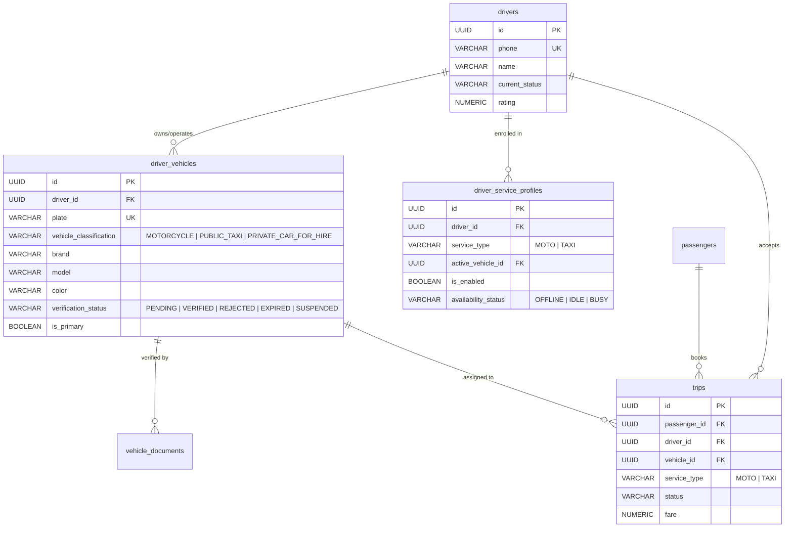

# GOZIPP Database Schema Audit
**Document ID:** GOZIPP-AUDIT-02  
**Project:** GOZIPP Dual Mobility Platform  
**Stage:** STAGE 0 — Read-Only Database Schema Audit  
**Status:** COMPLETE & VERIFIED AGAINST SOURCE CODE  
**Audit Date:** 2026-11-08  

---

## 1. Database Engine & Extension Infrastructure

* **Database Engine:** PostgreSQL 15+ (Production supports Supabase Managed PostgreSQL or Self-Hosted PostgreSQL).
* **Extensions Enabled (`packages/api/database/database-migration.service.ts` L23-25):**
  * `uuid-ossp`: For UUID v4 primary keys (`uuid_generate_v4()`).
  * `postgis`: For geospatial geometry types (`GEOMETRY(Point, 4326)`), spatial indexing (`GIST`), and distance operations.
  * `pg_trgm`: For fast trigram text searches across passenger/driver names and phone numbers.
* **Migration Mechanism:**
  * Active Runtime Migration: `DatabaseMigrationService` executes during NestJS module initialization (`OnModuleInit`). It applies idempotent SQL DDL (`CREATE TABLE IF NOT EXISTS`, `ALTER TABLE ... ADD COLUMN IF NOT EXISTS`).
  * Master Reference DDL: `packages/database/supabase_schema.sql` (633 lines).

---

## 2. Table-by-Table Inventory & Schema Evidence

### 2.1 Table: `drivers`
* **File Reference:** [`packages/api/entities/driver.entity.ts`](file:///c:/Users/acer/Videos/Project/Gozipp/packages/api/entities/driver.entity.ts) & [`packages/database/supabase_schema.sql`](file:///c:/Users/acer/Videos/Project/Gozipp/packages/database/supabase_schema.sql#L137-L174)
* **Columns:**
  * `id`: `UUID` (Primary Key, Default: `uuid_generate_v4()`)
  * `phone`: `VARCHAR(20)` (Unique, Indexed)
  * `name`: `VARCHAR(200)` (Not Null)
  * `nickname`: `VARCHAR(100)` (Nullable)
  * `plate`: `VARCHAR(20)` (Not Null — **Existing Limitation: Only 1 vehicle per driver**)
  * `line_id`: `VARCHAR(100)` (Nullable)
  * `station_id`: `VARCHAR(50)` (References `stations(id)` — **Existing Limitation: Hardcoded to Motorcycle Win**)
  * `invite_code`: `VARCHAR(50)` (References `invite_codes(code)`)
  * `approval_status`: Enum/Varchar `('PENDING', 'PENDING_REVIEW', 'APPROVED', 'REJECTED', 'REUPLOAD_REQUESTED')`
  * `current_status`: Enum/Varchar `('OFFLINE', 'IDLE', 'BUSY', 'SUSPENDED')`
  * `rating`: `NUMERIC(3, 2)` (Default: 5.00)
  * `total_trips`: `INTEGER` (Default: 0)
  * `total_earnings`: `NUMERIC(12, 2)` (Default: 0)
  * `last_known_location`: `GEOMETRY(POINT, 4326)` (Indexed via GIST)
  * `documents`, `preferences`, `training_statuses`: `JSONB`
* **Indexes:** `idx_drivers_phone`, `idx_drivers_station`, `idx_drivers_approval`, `idx_drivers_status`, `idx_drivers_last_location` (GIST).

### 2.2 Table: `trips`
* **File Reference:** [`packages/api/entities/trip.entity.ts`](file:///c:/Users/acer/Videos/Project/Gozipp/packages/api/entities/trip.entity.ts) & [`packages/database/supabase_schema.sql`](file:///c:/Users/acer/Videos/Project/Gozipp/packages/database/supabase_schema.sql#L217-L250)
* **Columns:**
  * `id`: `UUID` (Primary Key)
  * `passenger_id`: `UUID` (References `passengers(id)`, Indexed)
  * `driver_id`: `UUID` (References `drivers(id)`, Indexed, Nullable during `SEARCHING`)
  * `station_id`: `VARCHAR(50)` (References `stations(id)`, Nullable)
  * `pickup_lat`, `pickup_lng`: `DOUBLE PRECISION`
  * `pickup_location`: `GEOMETRY(POINT, 4326)` (Spatial GIST Indexed)
  * `pickup_address`: `TEXT` (Not Null)
  * `dest_lat`, `dest_lng`: `DOUBLE PRECISION`
  * `dest_location`: `GEOMETRY(POINT, 4326)` (Spatial GIST Indexed)
  * `dest_address`: `TEXT` (Not Null)
  * `distance_km`: `NUMERIC(8, 2)` (Default: 0)
  * `duration_mins`: `INTEGER` (Nullable)
  * `fare`: `NUMERIC(10, 2)` (Default: 2)
  * `credits_used`: `NUMERIC(10, 2)` (Default: 0)
  * `status`: Enum/Varchar `('SEARCHING', 'SCHEDULED', 'ACCEPTED', 'DRIVER_ARRIVED', 'IN_PROGRESS', 'COMPLETED', 'CANCELLED', 'TIMEOUT_NO_DRIVER')`
  * `scheduled_at`: `TIMESTAMPTZ` (Nullable)
  * `preferred_driver_id`: `VARCHAR(50)` (Nullable)
  * `requested_at`, `accepted_at`, `arrived_at`, `started_at`, `completed_at`, `cancelled_at`: `TIMESTAMPTZ`
  * `passenger_rating`, `driver_rating`: `INTEGER` (1-5)
  * `passenger_note`, `driver_note`, `cancel_reason`: `TEXT`
* **Missing Attributes for Dual Mobility:**
  * `service_type`: Does NOT exist in `trips`. (Currently assumed to be MOTO).
  * `vehicle_id`: Does NOT exist in `trips`. (Trip points directly to `driver_id`).

### 2.3 Table: `passengers`
* **File Reference:** [`packages/api/entities/passenger.entity.ts`](file:///c:/Users/acer/Videos/Project/Gozipp/packages/api/entities/passenger.entity.ts)
* **Columns:** `id`, `phone`, `name`, `email`, `avatar_url`, `profile_pic_url`, `auth_provider`, `pin_hash`, `points_balance`, `total_rides`, `free_rides_remaining`, `community_points_balance`, `referral_code`, `referred_by_id`.
* **Assessment:** 100% compatible. No schema changes needed for passenger identity.

### 2.4 Table: `stations` & `invite_codes`
* **File Reference:** `packages/database/supabase_schema.sql` L67-107.
* **Columns:**
  * `stations`: `id VARCHAR(50)`, `name VARCHAR(200)`, `location GEOMETRY(POINT, 4326)`, `radius_m INTEGER`, `district`, `province`.
  * `invite_codes`: `code VARCHAR(50)`, `station_id VARCHAR(50)`, `type invite_type`, `max_uses`, `used_count`, `expires_at`.
* **Assessment:** Specifically modeled for motorcycle taxi stations ("วิน"). Car taxis do not belong to motorcycle Win stations and require station-independent roaming/cruising dispatch.

### 2.5 Table: `driver_documents`
* **File Reference:** [`packages/api/entities/driver-document.entity.ts`](file:///c:/Users/acer/Videos/Project/Gozipp/packages/api/entities/driver-document.entity.ts)
* **Columns:** `id UUID`, `driver_id UUID`, `type VARCHAR`, `url TEXT`, `status VARCHAR ('PENDING', 'APPROVED', 'REJECTED')`, `rejection_reason TEXT`, `created_at TIMESTAMPTZ`.
* **Limitation:** Documents are linked strictly to `driver_id`. In a multi-vehicle setup, vehicle-specific documents (tax circle, car registration, commercial vehicle inspection) must be linked to a specific `vehicle_id`.

### 2.6 Table: `driver_preferences` & `driver_training_statuses`
* **File Reference:** `packages/api/entities/driver-preference.entity.ts`, `driver-training-status.entity.ts`
* **Columns:** Key-value store per `driver_id`. Can store user preferences, e.g., default active services.

### 2.7 Supporting Tables (Finance & Security)
* `wallet`, `wallet_transactions`, `payment_transactions`: Handle PromptPay top-ups and system fee points deductions.
* `refresh_tokens`, `passkey_credentials`: Secure multi-device token rotation.
* `audit_logs`: Immutable tracking of admin actions.
* `sos_events`: Live emergency dispatch.
* `admins`: RBAC credentials and MFA secrets.

---

## 3. Gap Analysis: Target Data Model vs. Existing Schema



---

## 4. Minimum Safe Migration Specification

To ensure 100% backward compatibility with zero downtime for existing motorcycle riders:

### Migration Step 1: Add Non-Breaking Columns to Existing Tables
1. **Extend `trips` Table:**
   ```sql
   ALTER TABLE trips ADD COLUMN IF NOT EXISTS service_type VARCHAR(20) NOT NULL DEFAULT 'MOTO';
   ALTER TABLE trips ADD COLUMN IF NOT EXISTS vehicle_id UUID;
   CREATE INDEX IF NOT EXISTS idx_trips_service_type ON trips(service_type);
   CREATE INDEX IF NOT EXISTS idx_trips_vehicle_id ON trips(vehicle_id);
   ```
   * *Safety Check:* Existing queries that do not supply `service_type` will default to `'MOTO'`. Existing trips remain valid.

### Migration Step 2: Create Multi-Vehicle Entities
1. **Create `driver_vehicles` Table:**
   ```sql
   CREATE TABLE IF NOT EXISTS driver_vehicles (
     id UUID PRIMARY KEY DEFAULT uuid_generate_v4(),
     driver_id UUID NOT NULL REFERENCES drivers(id) ON DELETE CASCADE,
     plate VARCHAR(50) NOT NULL,
     vehicle_classification VARCHAR(50) NOT NULL CHECK (vehicle_classification IN ('MOTORCYCLE', 'PUBLIC_TAXI', 'PRIVATE_CAR_FOR_HIRE')),
     make VARCHAR(100),
     model VARCHAR(100),
     color VARCHAR(50),
     manufacturing_year INTEGER,
     verification_status VARCHAR(50) NOT NULL DEFAULT 'PENDING' CHECK (verification_status IN ('PENDING', 'VERIFIED', 'REJECTED', 'EXPIRED', 'SUSPENDED')),
     verified_at TIMESTAMPTZ,
     verified_by UUID,
     rejection_reason TEXT,
     is_active BOOLEAN NOT NULL DEFAULT TRUE,
     created_at TIMESTAMPTZ NOT NULL DEFAULT NOW(),
     updated_at TIMESTAMPTZ NOT NULL DEFAULT NOW()
   );
   CREATE INDEX IF NOT EXISTS idx_driver_vehicles_driver ON driver_vehicles(driver_id);
   CREATE INDEX IF NOT EXISTS idx_driver_vehicles_status ON driver_vehicles(verification_status);
   CREATE UNIQUE INDEX IF NOT EXISTS uq_driver_vehicle_plate ON driver_vehicles(plate);
   ```

2. **Create `driver_service_profiles` Table:**
   ```sql
   CREATE TABLE IF NOT EXISTS driver_service_profiles (
     id UUID PRIMARY KEY DEFAULT uuid_generate_v4(),
     driver_id UUID NOT NULL REFERENCES drivers(id) ON DELETE CASCADE,
     service_type VARCHAR(20) NOT NULL CHECK (service_type IN ('MOTO', 'TAXI')),
     active_vehicle_id UUID REFERENCES driver_vehicles(id),
     is_enabled BOOLEAN NOT NULL DEFAULT FALSE,
     current_status VARCHAR(50) NOT NULL DEFAULT 'OFFLINE' CHECK (current_status IN ('OFFLINE', 'IDLE', 'BUSY', 'SUSPENDED')),
     created_at TIMESTAMPTZ NOT NULL DEFAULT NOW(),
     updated_at TIMESTAMPTZ NOT NULL DEFAULT NOW(),
     UNIQUE(driver_id, service_type)
   );
   CREATE INDEX IF NOT EXISTS idx_driver_service_profiles_driver ON driver_service_profiles(driver_id);
   ```

3. **Data Backfill Migration for Existing Motorcycle Drivers:**
   ```sql
   -- Automatically create a verified MOTORCYCLE vehicle for existing drivers
   INSERT INTO driver_vehicles (driver_id, plate, vehicle_classification, verification_status, verified_at)
   SELECT id, plate, 'MOTORCYCLE', 
          CASE WHEN approval_status = 'APPROVED' THEN 'VERIFIED' ELSE 'PENDING' END,
          NOW()
   FROM drivers
   WHERE plate IS NOT NULL AND plate != ''
   ON CONFLICT (plate) DO NOTHING;

   -- Populate default MOTO service profile
   INSERT INTO driver_service_profiles (driver_id, service_type, active_vehicle_id, is_enabled, current_status)
   SELECT d.id, 'MOTO', v.id, 
          CASE WHEN d.approval_status = 'APPROVED' THEN TRUE ELSE FALSE END,
          d.current_status
   FROM drivers d
   JOIN driver_vehicles v ON v.driver_id = d.id AND v.vehicle_classification = 'MOTORCYCLE'
   ON CONFLICT (driver_id, service_type) DO NOTHING;
   ```

---

## 5. Rollback Strategy

Every migration step is designed with an idempotent rollback path:
1. If the Dual Mobility feature must be paused, set `is_enabled = FALSE` on `driver_service_profiles` where `service_type = 'TAXI'`.
2. Existing MOTO trips and legacy drivers continue operating without interruption because the `drivers.plate` and `drivers.station_id` columns are preserved.
3. Rollback script removes new tables while preserving core tables:
   ```sql
   DROP TABLE IF EXISTS driver_service_profiles CASCADE;
   DROP TABLE IF EXISTS driver_vehicles CASCADE;
   ALTER TABLE trips DROP COLUMN IF EXISTS service_type;
   ALTER TABLE trips DROP COLUMN IF EXISTS vehicle_id;
   ```
