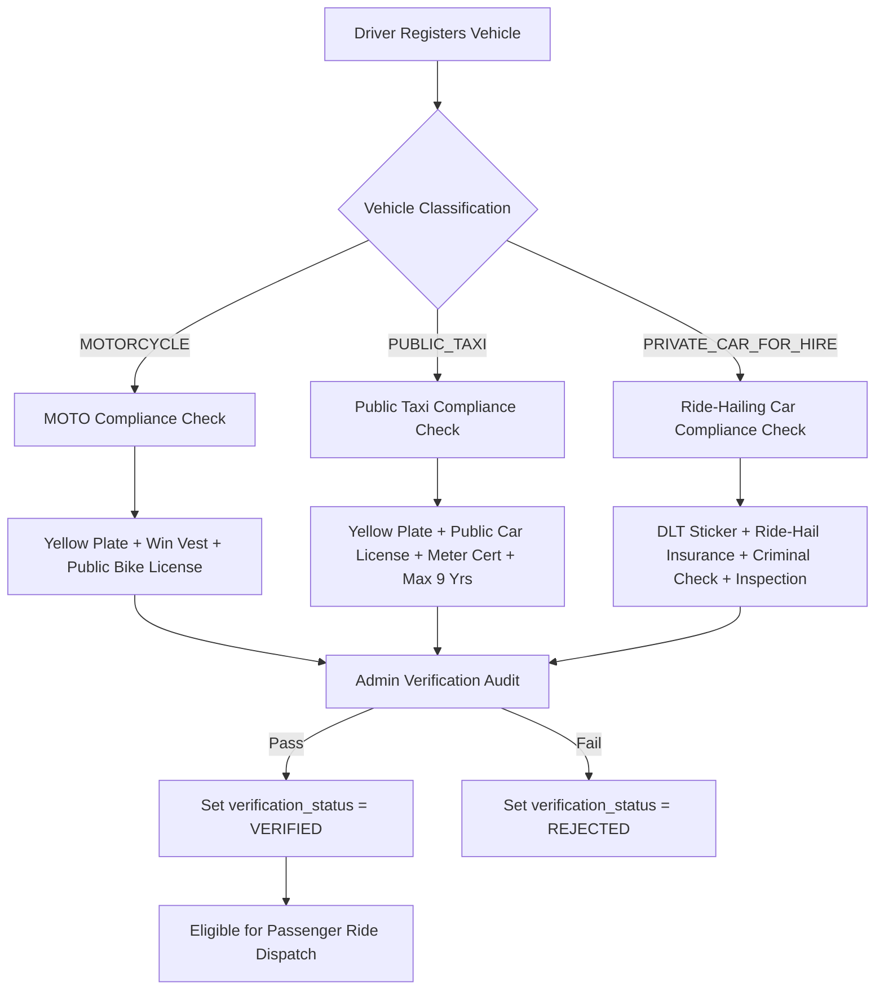

# GOZIPP DLT & ETDA Regulatory Compliance Requirements
**Document ID:** GOZIPP-DLT-01  
**Project:** GOZIPP Dual Mobility Platform (MOTO + TAXI)  
**Stage:** STAGE 1 — Technical Contract Design  
**Status:** DRAFTED FOR APPROVAL  
**Jurisdiction:** Kingdom of Thailand (Department of Land Transport & ETDA)  
**Date:** 2026-11-08  

---

## 1. Governing Legal Framework in Thailand

The operation of GOZIPP Dual Mobility is governed by two primary regulatory authorities:

1. **Department of Land Transport (DLT - กรมการขนส่งทางบก):**
   * *Vehicle Act B.E. 2522 (พ.ร.บ. รถยนต์ พ.ศ. 2522)* and Ministerial Regulations on Ride-Hailing Vehicles via Electronic Systems B.E. 2564 (*กฎกระทรวงรถยนต์รับจ้างผ่านระบบอิเล็กทรอนิกส์ พ.ศ. 2564*).
   * Governs vehicle roadworthiness, taxi meter certification, driver public licensing, and passenger insurance.
2. **Electronic Transactions Development Agency (ETDA):**
   * *Royal Decree on Digital Platform Services B.E. 2565 (พ.ร.ฎ. การประกอบธุรกิจบริการแพลตฟอร์มดิจิทัลที่ต้องแจ้งให้ทราบ พ.ศ. 2565)*.
   * Governs platform transparency, user identity verification (KYC), algorithm fairness, and dispute resolution.

---

## 2. Vehicle Classification & Compliance Checklist



### 2.1 Category 1: `MOTORCYCLE` (วินมอเตอร์ไซค์รับจ้าง)
| Document Code | Document Title (Thai / English) | Mandatory Validity Period | Regulatory Authority |
| :--- | :--- | :--- | :--- |
| `ID_CARD` | บัตรประจำตัวประชาชน (National ID Card) | Prior to expiration date | DOPA |
| `LICENSE` | ใบอนุญาตขับรถจักรยานยนต์สาธารณะ (Public Motorcycle License) | Prior to expiration date | DLT |
| `REGISTRATION_BOOK` | เล่มทะเบียนรถจักรยานยนต์สาธารณะ (ป้ายเหลือง) | Annual tax sticker valid | DLT |
| `WIN_BADGE` | บัตรประจำตัวผู้ขับขี่รถจักรยานยนต์สาธารณะ (เสื้อวิน) | Annual renewal | BMA / District Office |
| `COMPULSORY_INSURANCE` | พ.ร.บ. คุ้มครองผู้ประสบภัยจากรถ | Valid policy period | OIC (คปภ.) |

---

### 2.2 Category 2: `PUBLIC_TAXI` (รถแท็กซี่มิเตอร์สาธารณะ)
| Document Code | Document Title (Thai / English) | Mandatory Validity Period | Regulatory Authority |
| :--- | :--- | :--- | :--- |
| `LICENSE` | ใบอนุญาตขับรถยนต์สาธารณะ (Public Car Driver License) | Prior to expiration date | DLT |
| `REGISTRATION_BOOK` | เล่มทะเบียนรถยนต์รับจ้างบรรทุกคนโดยสารไม่เกิน 7 คน (ทส./ทห.) | Age not exceeding 9 years | DLT |
| `TAXI_METER_CERTIFICATE` | ใบรับรองการตรวจรอบมิเตอร์และอุปกรณ์ติดตาม (GPS Certificate) | Annual inspection | DLT |
| `COMMERCIAL_INSURANCE` | ประกันภัยคุ้มครองผู้โดยสารรถยนต์สาธารณะ (Third-Party Commercial) | Valid policy period | OIC (คปภ.) |
| `YELLOW_LICENSE_PLATE` | ภาพถ่ายป้ายทะเบียนหน้ารถ-หลังรถ (Yellow Plate) | Current | DLT |

---

### 2.3 Category 3: `PRIVATE_CAR_FOR_HIRE` (รถยนต์รับจ้างผ่านระบบอิเล็กทรอนิกส์)
| Document Code | Document Title (Thai / English) | Mandatory Validity Period | Regulatory Authority |
| :--- | :--- | :--- | :--- |
| `LICENSE` | ใบขับขี่สาธารณะ หรือใบขับขี่ส่วนบุคคลที่ผ่านการอบรมรับรอง | Prior to expiration date | DLT |
| `REGISTRATION_BOOK` | เล่มทะเบียนรถยนต์นั่งส่วนบุคคล (จดทะเบียนไม่เกิน 9 ปี) | Annual tax sticker valid | DLT |
| `DLT_STICKER` | สติกเกอร์หรือเครื่องหมายแสดงการเป็นรถยนต์รับจ้างผ่านระบบอิเล็กทรอนิกส์ | Issued by DLT | DLT |
| `COMPULSORY_INSURANCE` | กรมธรรม์ประกันภัยคุ้มครองผู้โดยสารเพิ่มเติมสำหรับการรับจ้างผ่านแอป | Valid policy period | OIC (คปภ.) |
| `VEHICLE_INSPECTION` | ใบรับรองการตรวจสภาพรถจาก ตรอ. หรือ สำนักงานขนส่ง | Annual inspection | DLT / Certified Inspection |
| `CRIMINAL_RECORD` | หนังสือรับรองประวัติอาชญากรรม (สตช.) | Issued within last 6 months | Royal Thai Police |

---

## 3. Mandatory Verification Release Gate

To prevent illegal passenger transport and protect the platform against regulatory suspension:

1. **Programmatic Block:**
   * The dispatch router (`TaxiMatchingService` and `AppGateway`) verifies:
     ```typescript
     if (vehicle.verification_status !== 'VERIFIED') {
       // Silently drop candidate from dispatch pool
       return false;
     }
     ```
2. **Self-Approval Barred:** Drivers can upload documents, but only authenticated platform administrators (`ADMIN` / `SUPERADMIN`) have the cryptographic authority to execute verification transitions.
3. **Automated Expiry Monitor:**
   * A scheduled daily cron job checks `vehicle_documents.expiry_date`.
   * If any mandatory document (such as insurance or road tax) passes its expiry date, the vehicle's `verification_status` automatically transitions to `EXPIRED`.
   * The driver's service profile availability for that vehicle is immediately forced to `SUSPENDED`.

---

## 4. Audit Evidence & Regulatory Reporting

In compliance with ETDA Digital Platform Service regulations:
1. Every verification decision is permanently recorded in `audit_logs` with:
   * Reviewing Administrator UUID
   * Target Vehicle ID and License Plate
   * Decision timestamp and audit rationale
   * Cryptographic hash of the uploaded document images
2. The platform maintains automated compliance reporting capabilities exportable as audit evidence for DLT and ETDA annual filings.
