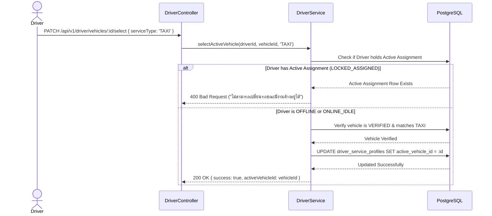

# GOZIPP Driver-Vehicle Relationship & Anti-Simultaneous Usage Design
**Document ID:** GOZIPP-REL-01  
**Project:** GOZIPP Dual Mobility Platform (MOTO + TAXI)  
**Stage:** STAGE 1 — Technical Contract Design  
**Status:** DRAFTED FOR APPROVAL  
**Scope:** Cardinality, Foreign Keys, Vehicle Selection & Concurrency Defense  
**Date:** 2026-11-08  

---

## 1. Relational Cardinality & Model Hierarchy

To support drivers who operate both a motorcycle and a car taxi (or multiple cars across shifts), the relationship model establishes unambiguous boundaries:

```
                  ┌────────────────────────┐
                  │        drivers         │
                  └───────────┬────────────┘
                              │
            ┌─────────────────┴─────────────────┐
            │ 1:N                               │ 1:2
            ▼                                   ▼
 ┌──────────────────────┐           ┌──────────────────────┐
 │   driver_vehicles    │           │driver_service_profiles│
 │ (Physical Vehicles)  │           │   (MOTO and TAXI)    │
 └──────────┬───────────┘           └───────────┬──────────┘
            │                                   │
            │          1:1 Active Selection     │
            └───────────────────────────────────┘
                              │
                              ▼
               ┌──────────────────────────────┐
               │  driver_active_assignments   │
               │   (Global P0 Active Lock)    │
               │        Max 1 at any time     │
               └──────────────┬───────────────┘
                              │ 1:1
                              ▼
               ┌──────────────────────────────┐
               │            trips             │
               └──────────────────────────────┘
```

---

## 2. Cardinality & Foreign Key Rules

| Relationship | Cardinality | Parent Table | Child Table | Foreign Key Column | On Delete Action | On Update Action |
| :--- | :---: | :--- | :--- | :--- | :--- | :--- |
| **Driver to Vehicles** | $1 : N$ | `drivers` | `driver_vehicles` | `driver_id` | `CASCADE` | `CASCADE` |
| **Driver to Service Profiles** | $1 : 2$ | `drivers` | `driver_service_profiles` | `driver_id` | `CASCADE` | `CASCADE` |
| **Active Vehicle to Service Profile** | $1 : 1$ | `driver_vehicles` | `driver_service_profiles` | `active_vehicle_id` | `SET NULL` | `CASCADE` |
| **Driver to Active Assignment** | $1 : 0..1$ | `drivers` | `driver_active_assignments` | `driver_id` | `CASCADE` | `CASCADE` |
| **Trip to Active Assignment** | $1 : 0..1$ | `trips` | `driver_active_assignments` | `trip_id` | `CASCADE` | `CASCADE` |
| **Vehicle to Active Assignment** | $1 : N$ | `driver_vehicles` | `driver_active_assignments` | `vehicle_id` | `RESTRICT` | `CASCADE` |
| **Trip to Operating Vehicle** | $N : 1$ | `driver_vehicles` | `trips` | `vehicle_id` | `RESTRICT` | `CASCADE` |

### Key Integrity Invariants
1. **`RESTRICT` on Vehicle Deletion:** A physical vehicle that has completed historical trips cannot be deleted from the database (`ON DELETE RESTRICT` on `trips.vehicle_id`). If a driver sells a car, the vehicle is marked `is_active = FALSE`.
2. **Exactly Two Service Profiles:** A driver may have at most two rows in `driver_service_profiles` enforced by the unique constraint: `UNIQUE(driver_id, service_type)` where `service_type IN ('MOTO', 'TAXI')`.
3. **Vehicle Classification Match:**
   * `service_type === 'MOTO'` can only select a vehicle with `vehicle_classification === 'MOTORCYCLE'`.
   * `service_type === 'TAXI'` can only select a vehicle with `vehicle_classification IN ('PUBLIC_TAXI', 'PRIVATE_CAR_FOR_HIRE')`.

---

## 3. Vehicle Switching Protocol

A driver can change the active vehicle assigned to their service profile (e.g. switching between two taxis, or updating a motorcycle):



### Precondition Guards for Vehicle Switching
1. **No Active Ride:** The driver must hold `UNASSIGNED` assignment state (verified in `driver_active_assignments`).
2. **Legal Verification:** The target vehicle must have `verification_status === 'VERIFIED'` (or `LEGACY_REVIEW` for motorcycle MOTO).
3. **Vehicle Ownership / Authorization:** The vehicle must be registered under the requesting driver (`driver_id === req.user.sub`).

---

## 4. Anti-Simultaneous Vehicle Usage Rules

### Rule 1: A Driver Cannot Drive Two Vehicles at Once
* **Physical Reality:** A single driver cannot physically operate both a motorcycle and a car simultaneously.
* **System Defense:** The Global Active Ride Lock (`driver_active_assignments`) enforces a database-level unique constraint on `driver_id`. As soon as a ride starts on ANY vehicle, the driver's assignment is locked across all vehicles.

### Rule 2: Multiple Drivers Sharing One Vehicle (Shift-Work / Relief Drivers)
* In Thailand, taxis are frequently operated by two drivers across day/night shifts ("กะเช้า / กะบ่าย").
* **Supported Model:** Two separate driver accounts can register the same physical vehicle plate in `driver_vehicles`.
* **Mutual Exclusion Constraint:**
  * Only ONE driver can set that shared vehicle to `ONLINE_IDLE` or `ONLINE_BUSY` at any given timestamp.
  * When Driver A toggles the shared car to `ONLINE_IDLE`, the system acquires a Redis lock:
    ```redis
    SET vehicle:<vehicleId>:active_driver <driverIdA> NX
    ```
  * If Driver B attempts to go online with the same vehicle before Driver A goes offline, the server rejects the request with HTTP 409: `"ยานพาหนะคันนี้กำลังถูกใช้งานโดยผู้ขับขี่ท่านอื่นในระบบ"`.
