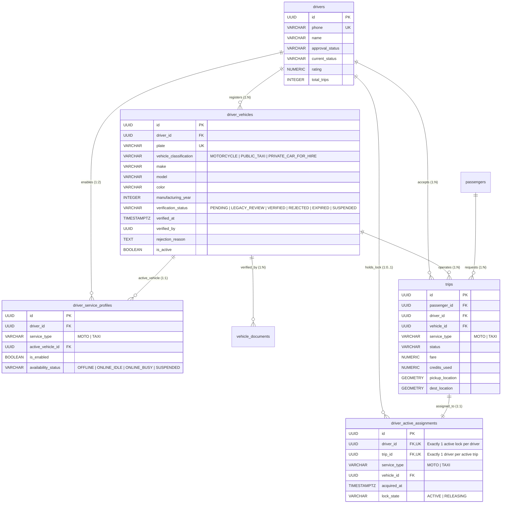

# GOZIPP Dual Mobility Database Schema & Entity Contract
**Document ID:** GOZIPP-DB-01  
**Project:** GOZIPP Dual Mobility Platform (MOTO + TAXI)  
**Stage:** STAGE 1 — Technical Contract Design  
**Status:** DRAFTED FOR APPROVAL  
**Engine:** PostgreSQL 15+ with PostGIS, uuid-ossp, pg_trgm  
**ORM:** TypeORM 0.3.19  
**Date:** 2026-11-08  

---

## 1. Entity-Relationship Data Model



---

## 2. Table DDL Contracts & Constraints

### 2.1 Table: `driver_vehicles`
Stores physical vehicles registered by a driver. A driver may register multiple vehicles (e.g. 1 Motorcycle + 1 Car Taxi).

```sql
CREATE TABLE IF NOT EXISTS driver_vehicles (
  id                      UUID PRIMARY KEY DEFAULT uuid_generate_v4(),
  driver_id               UUID NOT NULL REFERENCES drivers(id) ON DELETE CASCADE,
  plate                   VARCHAR(50) NOT NULL,
  vehicle_classification  VARCHAR(50) NOT NULL,
  make                    VARCHAR(100),
  model                   VARCHAR(100),
  color                   VARCHAR(50),
  manufacturing_year      INTEGER,
  verification_status     VARCHAR(50) NOT NULL DEFAULT 'PENDING',
  verified_at             TIMESTAMPTZ,
  verified_by             UUID,
  rejection_reason        TEXT,
  is_active               BOOLEAN NOT NULL DEFAULT TRUE,
  created_at              TIMESTAMPTZ NOT NULL DEFAULT NOW(),
  updated_at              TIMESTAMPTZ NOT NULL DEFAULT NOW(),

  -- Constraints
  CONSTRAINT chk_vehicle_classification CHECK (
    vehicle_classification IN ('MOTORCYCLE', 'PUBLIC_TAXI', 'PRIVATE_CAR_FOR_HIRE')
  ),
  CONSTRAINT chk_vehicle_verification_status CHECK (
    verification_status IN ('PENDING', 'LEGACY_REVIEW', 'VERIFIED', 'REJECTED', 'EXPIRED', 'SUSPENDED')
  ),
  CONSTRAINT uq_driver_vehicle_plate UNIQUE (plate)
);

CREATE INDEX IF NOT EXISTS idx_driver_vehicles_driver_id ON driver_vehicles(driver_id);
CREATE INDEX IF NOT EXISTS idx_driver_vehicles_status ON driver_vehicles(verification_status);
CREATE INDEX IF NOT EXISTS idx_driver_vehicles_classification ON driver_vehicles(vehicle_classification);
```

---

### 2.2 Table: `driver_service_profiles`
Maintains independent service participation and availability per service type (`MOTO` and `TAXI`).

```sql
CREATE TABLE IF NOT EXISTS driver_service_profiles (
  id                  UUID PRIMARY KEY DEFAULT uuid_generate_v4(),
  driver_id           UUID NOT NULL REFERENCES drivers(id) ON DELETE CASCADE,
  service_type        VARCHAR(20) NOT NULL,
  active_vehicle_id   UUID REFERENCES driver_vehicles(id) ON DELETE SET NULL,
  is_enabled          BOOLEAN NOT NULL DEFAULT FALSE,
  availability_status VARCHAR(50) NOT NULL DEFAULT 'OFFLINE',
  created_at          TIMESTAMPTZ NOT NULL DEFAULT NOW(),
  updated_at          TIMESTAMPTZ NOT NULL DEFAULT NOW(),

  -- Constraints
  CONSTRAINT chk_service_type CHECK (service_type IN ('MOTO', 'TAXI')),
  CONSTRAINT chk_availability_status CHECK (
    availability_status IN ('OFFLINE', 'ONLINE_IDLE', 'ONLINE_BUSY', 'SUSPENDED')
  ),
  CONSTRAINT uq_driver_service_profile UNIQUE (driver_id, service_type)
);

CREATE INDEX IF NOT EXISTS idx_driver_service_profiles_driver ON driver_service_profiles(driver_id);
CREATE INDEX IF NOT EXISTS idx_driver_service_profiles_availability ON driver_service_profiles(service_type, availability_status);
```

---

### 2.3 Table: `driver_active_assignments` (P0 Global Active Ride Lock Table)
The authoritative PostgreSQL database anchor enforcing that **a driver may have only ONE active ride across all services**.

```sql
CREATE TABLE IF NOT EXISTS driver_active_assignments (
  id              UUID PRIMARY KEY DEFAULT uuid_generate_v4(),
  driver_id       UUID NOT NULL REFERENCES drivers(id) ON DELETE CASCADE,
  trip_id         UUID NOT NULL REFERENCES trips(id) ON DELETE CASCADE,
  service_type    VARCHAR(20) NOT NULL,
  vehicle_id      UUID NOT NULL REFERENCES driver_vehicles(id),
  acquired_at     TIMESTAMPTZ NOT NULL DEFAULT NOW(),
  lock_state      VARCHAR(20) NOT NULL DEFAULT 'ACTIVE',

  -- Strict Uniqueness Constraints (Concurrency Defense)
  CONSTRAINT uq_active_assignment_driver UNIQUE (driver_id),
  CONSTRAINT uq_active_assignment_trip UNIQUE (trip_id),
  CONSTRAINT chk_assignment_service_type CHECK (service_type IN ('MOTO', 'TAXI')),
  CONSTRAINT chk_assignment_lock_state CHECK (lock_state IN ('ACTIVE', 'RELEASING'))
);

CREATE INDEX IF NOT EXISTS idx_active_assignments_driver ON driver_active_assignments(driver_id);
CREATE INDEX IF NOT EXISTS idx_active_assignments_trip ON driver_active_assignments(trip_id);
```

---

### 2.4 Table: `vehicle_documents`
Stores legal compliance and DLT verification documents tied directly to a physical vehicle.

```sql
CREATE TABLE IF NOT EXISTS vehicle_documents (
  id                  UUID PRIMARY KEY DEFAULT uuid_generate_v4(),
  vehicle_id          UUID NOT NULL REFERENCES driver_vehicles(id) ON DELETE CASCADE,
  document_type       VARCHAR(50) NOT NULL,
  url                 TEXT NOT NULL,
  status              VARCHAR(50) NOT NULL DEFAULT 'PENDING',
  rejection_reason    TEXT,
  expiry_date         DATE,
  verified_at         TIMESTAMPTZ,
  verified_by         UUID,
  created_at          TIMESTAMPTZ NOT NULL DEFAULT NOW(),

  CONSTRAINT chk_vehicle_doc_type CHECK (
    document_type IN (
      'REGISTRATION_BOOK',       -- เล่มทะเบียนรถ (ใบคู่มือจดทะเบียน)
      'VEHICLE_INSPECTION',      -- ใบรับรองการตรวจสภาพรถ
      'COMPULSORY_INSURANCE',    -- พ.ร.บ. คุ้มครองผู้โดยสาร
      'COMMERCIAL_INSURANCE',    -- ประกันภัยบุคคลที่สามสำหรับรถรับจ้าง
      'DLT_STICKER',             -- สติกเกอร์ ขบ. สำหรับรถยนต์รับจ้าง
      'TAXI_METER_CERTIFICATE',  -- ใบรับรองตรวจมิเตอร์ (กรณี Public Taxi)
      'YELLOW_LICENSE_PLATE'     -- รูปถ่ายป้ายทะเบียนเหลือง
    )
  ),
  CONSTRAINT chk_vehicle_doc_status CHECK (status IN ('PENDING', 'APPROVED', 'REJECTED', 'EXPIRED'))
);

CREATE INDEX IF NOT EXISTS idx_vehicle_documents_vehicle ON vehicle_documents(vehicle_id);
```

---

### 2.5 Table Extension: `trips`
Extends the existing `trips` table with backward-compatible columns:

```sql
ALTER TABLE trips ADD COLUMN IF NOT EXISTS service_type VARCHAR(20) NOT NULL DEFAULT 'MOTO';
ALTER TABLE trips ADD COLUMN IF NOT EXISTS vehicle_id UUID REFERENCES driver_vehicles(id);

DO $$ BEGIN
  IF NOT EXISTS (
    SELECT 1 FROM pg_constraint WHERE conname = 'chk_trips_service_type'
  ) THEN
    ALTER TABLE trips ADD CONSTRAINT chk_trips_service_type CHECK (service_type IN ('MOTO', 'TAXI'));
  END IF;
END $$;

CREATE INDEX IF NOT EXISTS idx_trips_service_type ON trips(service_type);
CREATE INDEX IF NOT EXISTS idx_trips_vehicle_id ON trips(vehicle_id);
```

---

## 3. TypeORM Entity Class Definitions

### 3.1 `DriverVehicleEntity` (`packages/api/entities/driver-vehicle.entity.ts`)
```typescript
import {
  Entity, Column, PrimaryGeneratedColumn, CreateDateColumn,
  UpdateDateColumn, Index, ManyToOne, JoinColumn, OneToMany
} from 'typeorm';
import { DriverEntity } from './driver.entity';
import { VehicleDocumentEntity } from './vehicle-document.entity';

export type VehicleClassification = 'MOTORCYCLE' | 'PUBLIC_TAXI' | 'PRIVATE_CAR_FOR_HIRE';
export type VerificationStatus = 'PENDING' | 'LEGACY_REVIEW' | 'VERIFIED' | 'REJECTED' | 'EXPIRED' | 'SUSPENDED';

@Entity('driver_vehicles')
export class DriverVehicleEntity {
  @PrimaryGeneratedColumn('uuid')
  id: string;

  @Column({ type: 'uuid' })
  @Index()
  driver_id: string;

  @ManyToOne(() => DriverEntity, (driver) => driver.vehicles, { onDelete: 'CASCADE' })
  @JoinColumn({ name: 'driver_id' })
  driver: DriverEntity;

  @Column({ unique: true })
  plate: string;

  @Column({ type: 'varchar', length: 50 })
  vehicle_classification: VehicleClassification;

  @Column({ nullable: true })
  make: string;

  @Column({ nullable: true })
  model: string;

  @Column({ nullable: true })
  color: string;

  @Column({ type: 'int', nullable: true })
  manufacturing_year: number;

  @Column({ type: 'varchar', length: 50, default: 'PENDING' })
  @Index()
  verification_status: VerificationStatus;

  @Column({ type: 'timestamptz', nullable: true })
  verified_at: Date;

  @Column({ type: 'uuid', nullable: true })
  verified_by: string;

  @Column({ type: 'text', nullable: true })
  rejection_reason: string;

  @Column({ default: true })
  is_active: boolean;

  @OneToMany(() => VehicleDocumentEntity, (doc) => doc.vehicle)
  documents: VehicleDocumentEntity[];

  @CreateDateColumn({ type: 'timestamptz' })
  created_at: Date;

  @UpdateDateColumn({ type: 'timestamptz' })
  updated_at: Date;
}
```

---

### 3.2 `DriverServiceProfileEntity` (`packages/api/entities/driver-service-profile.entity.ts`)
```typescript
import {
  Entity, Column, PrimaryGeneratedColumn, CreateDateColumn,
  UpdateDateColumn, Index, ManyToOne, JoinColumn, Unique
} from 'typeorm';
import { DriverEntity } from './driver.entity';
import { DriverVehicleEntity } from './driver-vehicle.entity';

export type ServiceType = 'MOTO' | 'TAXI';
export type AvailabilityStatus = 'OFFLINE' | 'ONLINE_IDLE' | 'ONLINE_BUSY' | 'SUSPENDED';

@Entity('driver_service_profiles')
@Unique(['driver_id', 'service_type'])
export class DriverServiceProfileEntity {
  @PrimaryGeneratedColumn('uuid')
  id: string;

  @Column({ type: 'uuid' })
  @Index()
  driver_id: string;

  @ManyToOne(() => DriverEntity, { onDelete: 'CASCADE' })
  @JoinColumn({ name: 'driver_id' })
  driver: DriverEntity;

  @Column({ type: 'varchar', length: 20 })
  service_type: ServiceType;

  @Column({ type: 'uuid', nullable: true })
  active_vehicle_id: string | null;

  @ManyToOne(() => DriverVehicleEntity, { onDelete: 'SET NULL', nullable: true })
  @JoinColumn({ name: 'active_vehicle_id' })
  activeVehicle: DriverVehicleEntity | null;

  @Column({ default: false })
  is_enabled: boolean;

  @Column({ type: 'varchar', length: 50, default: 'OFFLINE' })
  @Index()
  availability_status: AvailabilityStatus;

  @CreateDateColumn({ type: 'timestamptz' })
  created_at: Date;

  @UpdateDateColumn({ type: 'timestamptz' })
  updated_at: Date;
}
```

---

### 3.3 `DriverActiveAssignmentEntity` (`packages/api/entities/driver-active-assignment.entity.ts`)
```typescript
import {
  Entity, Column, PrimaryGeneratedColumn, CreateDateColumn,
  Index, OneToOne, JoinColumn, ManyToOne
} from 'typeorm';
import { DriverEntity } from './driver.entity';
import { TripEntity } from './trip.entity';
import { DriverVehicleEntity } from './driver-vehicle.entity';

@Entity('driver_active_assignments')
export class DriverActiveAssignmentEntity {
  @PrimaryGeneratedColumn('uuid')
  id: string;

  @Column({ type: 'uuid', unique: true })
  @Index()
  driver_id: string;

  @OneToOne(() => DriverEntity, { onDelete: 'CASCADE' })
  @JoinColumn({ name: 'driver_id' })
  driver: DriverEntity;

  @Column({ type: 'uuid', unique: true })
  @Index()
  trip_id: string;

  @OneToOne(() => TripEntity, { onDelete: 'CASCADE' })
  @JoinColumn({ name: 'trip_id' })
  trip: TripEntity;

  @Column({ type: 'varchar', length: 20 })
  service_type: 'MOTO' | 'TAXI';

  @Column({ type: 'uuid' })
  vehicle_id: string;

  @ManyToOne(() => DriverVehicleEntity)
  @JoinColumn({ name: 'vehicle_id' })
  vehicle: DriverVehicleEntity;

  @CreateDateColumn({ type: 'timestamptz' })
  acquired_at: Date;

  @Column({ type: 'varchar', length: 20, default: 'ACTIVE' })
  lock_state: 'ACTIVE' | 'RELEASING';
}
```

---

## 4. Legacy Verification Policy (Mandatory Correction A)

To maintain absolute legal integrity while preventing accidental lockout of operational motorcycle drivers:

1. **Classification of Migrated Vehicles as `LEGACY_REVIEW`:**
   * Existing motorcycle drivers with `approval_status === 'APPROVED'` are migrated into `driver_vehicles` with:
     $$\text{verification\_status} = \text{'LEGACY\_REVIEW'}$$
   * **Rule:** A status of `LEGACY_REVIEW` permits continued operation **exclusively for GOZIPP MOTO** during an administrative 90-day grace period.
   * A status of `LEGACY_REVIEW` strictly **PROHIBITS** registration or dispatch in **GOZIPP TAXI**.
2. **Taxi Verification Gate:**
   * Car Taxis (`PUBLIC_TAXI` and `PRIVATE_CAR_FOR_HIRE`) MUST start in status `PENDING`.
   * Only an explicit administrative review by an authorized reviewer sets status to `VERIFIED`.
   * Under no circumstances is a car taxi ever granted `LEGACY_REVIEW`.

```
┌────────────────────────────────────────────────────────────────────────┐
│                   MIGRATION VERIFICATION MATRIX                        │
├──────────────────────┬────────────────────────┬────────────────────────┤
│ Existing Driver Type │ Migrated Vehicle State │ Dispatch Permission    │
├──────────────────────┼────────────────────────┼────────────────────────┤
│ Approved MOTO Driver │ LEGACY_REVIEW          │ MOTO: Allowed          │
│                      │                        │ TAXI: Strictly Blocked │
├──────────────────────┼────────────────────────┼────────────────────────┤
│ New Car Taxi Driver  │ PENDING                │ MOTO: Blocked          │
│                      │                        │ TAXI: Blocked (until   │
│                      │                        │       Admin Approves)  │
├──────────────────────┼────────────────────────┼────────────────────────┤
│ Verified Taxi Driver │ VERIFIED               │ MOTO: If bike verified │
│                      │                        │ TAXI: Allowed          │
└──────────────────────┴────────────────────────┴────────────────────────┘
```
