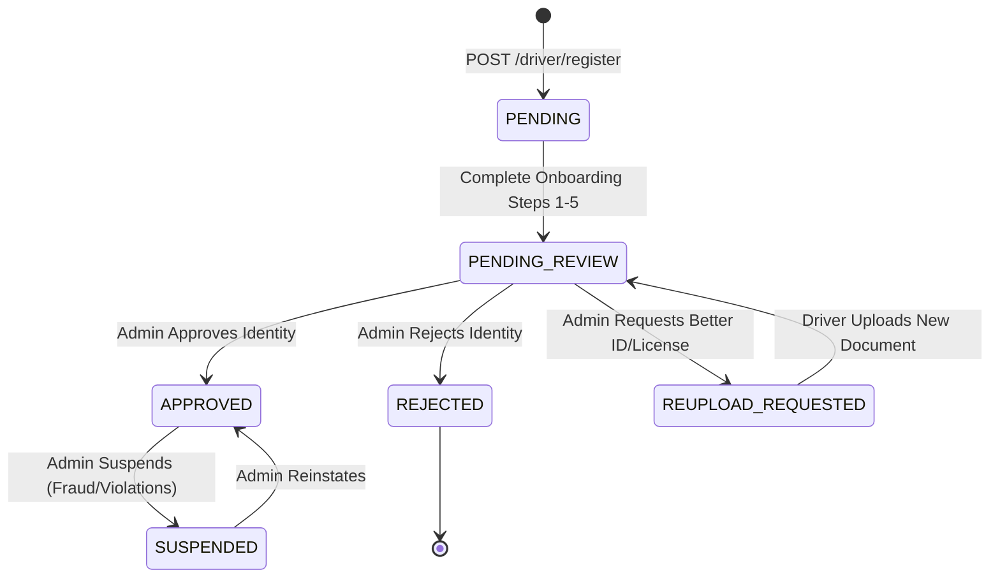
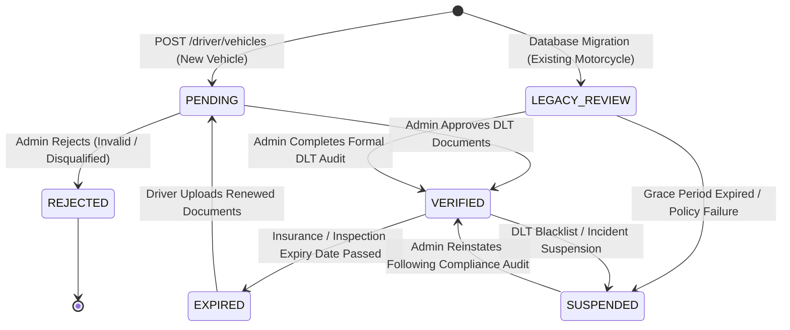
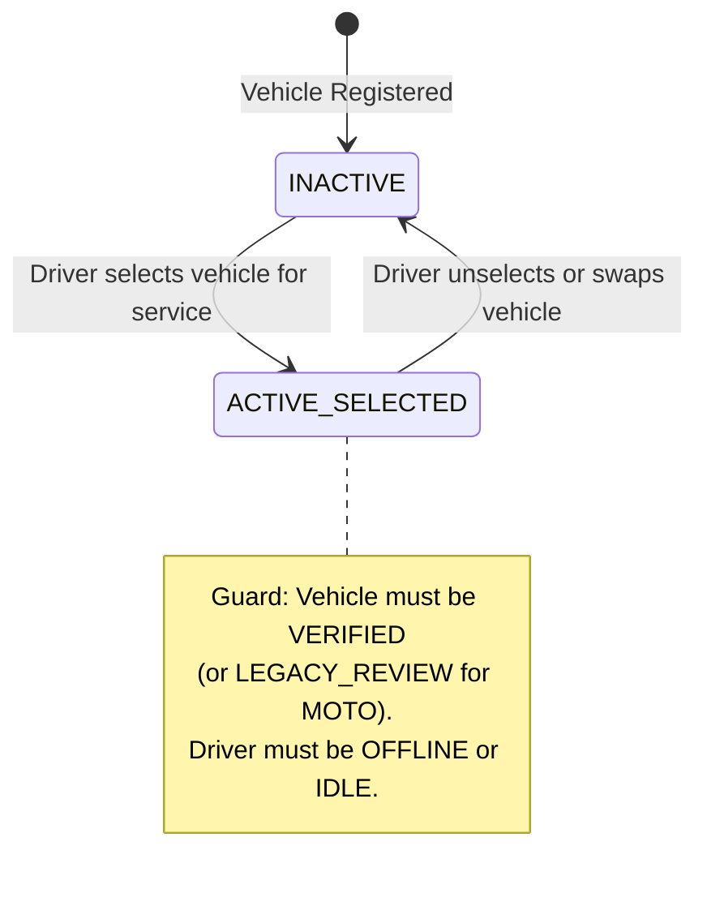
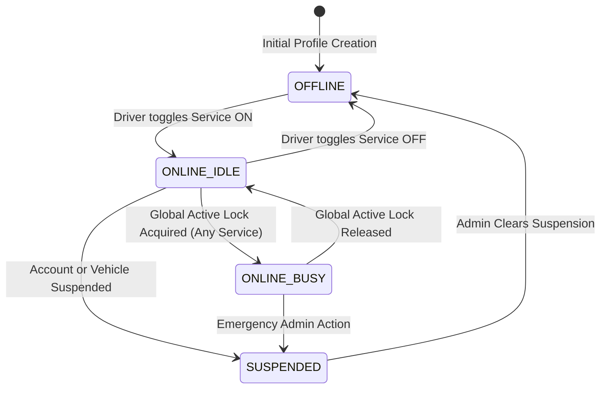
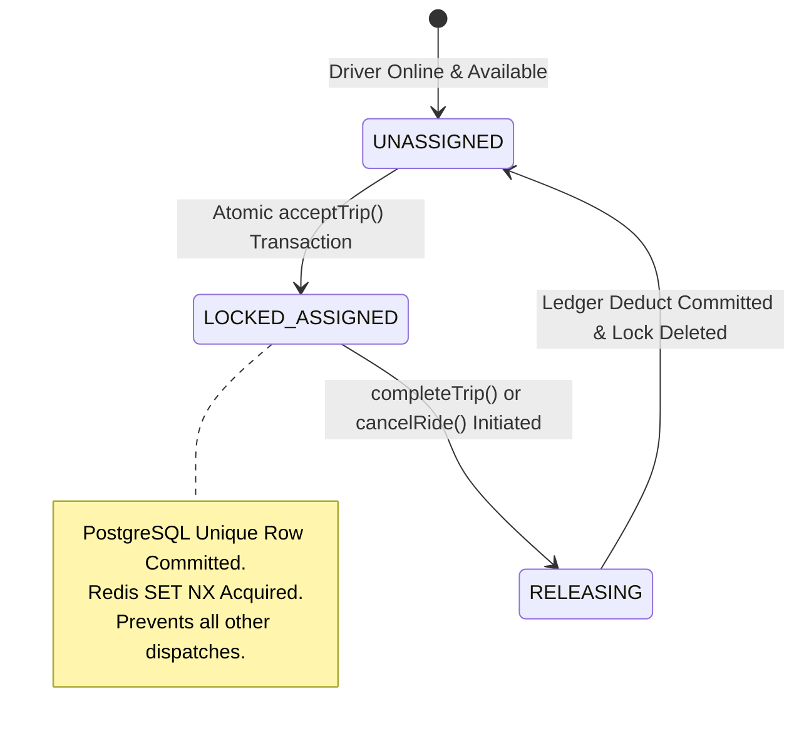
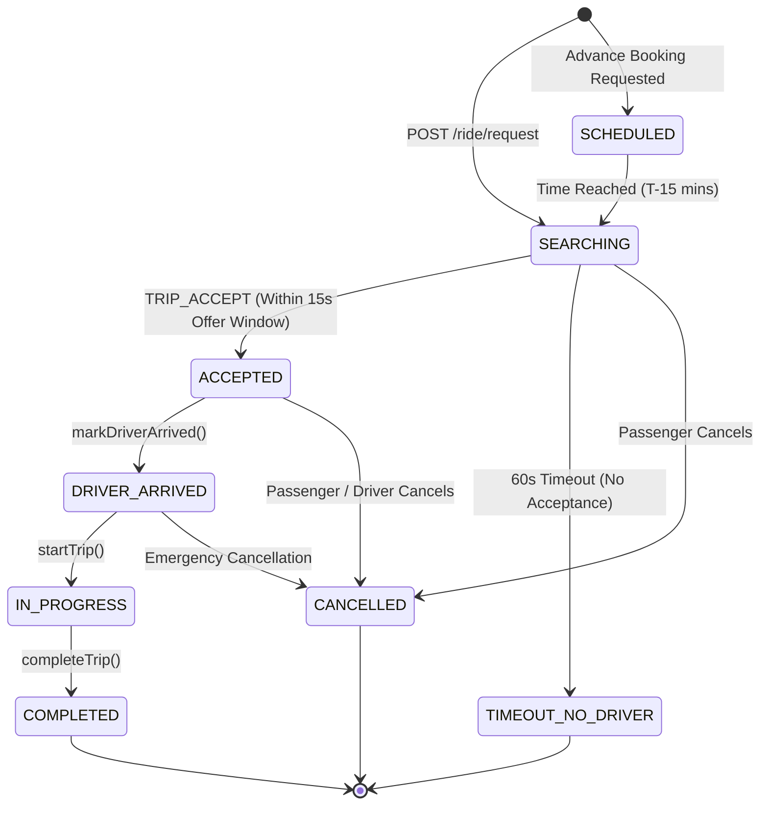

# GOZIPP Dual Mobility State Machine Specifications
**Document ID:** GOZIPP-STATE-01  
**Project:** GOZIPP Dual Mobility Platform (MOTO + TAXI)  
**Stage:** STAGE 1 — Technical Contract Design  
**Status:** DRAFTED FOR APPROVAL  
**Scope:** 6 Independent, Decoupled State Machines  
**Date:** 2026-11-08  

---

## 1. Overview of the 6 Decoupled State Machines

To prevent architectural coupling, GOZIPP Dual Mobility separates system states into **6 independent state machines**:

```
1. Driver Identity State      (Who the human driver is & KYC standing)
2. Vehicle Verification State (Legal verification standing of a registered vehicle)
3. Vehicle Availability State (Which vehicle is selected for active service)
4. Service Availability State (Online/offline readiness per service type: MOTO vs TAXI)
5. Global Active Assignment   (P0 Global Active Ride Lock concurrency state)
6. Trip Lifecycle State       (End-to-end journey progression)
```

---

## 2. State Machine 1: Driver Identity Lifecycle

Governs the personal registration, KYC, and account standing of the human driver in the `drivers` table.



### 1.1 States & Transition Triggers
| State | Allowed Transitions | Trigger | Guard / Preconditions |
| :--- | :--- | :--- | :--- |
| **`PENDING`** | `PENDING_REVIEW` | `POST /driver/onboarding/submit` | Driver completed profile, initial document upload, and training modules. |
| **`PENDING_REVIEW`** | `APPROVED`, `REJECTED`, `REUPLOAD_REQUESTED` | `POST /admin/drivers/approve` or `reject` | Action performed by authenticated administrator with role `ADMIN` or `SUPERADMIN`. |
| **`APPROVED`** | `SUSPENDED` | `POST /admin/drivers/status` | Account suspension immediately sets all child service profiles to `SUSPENDED`. |
| **`SUSPENDED`** | `APPROVED` | `POST /admin/drivers/status` | Account reinstatement; child services revert to `OFFLINE`. |

---

## 3. State Machine 2: Vehicle Verification Lifecycle

Governs the legal status of an individual physical vehicle in the `driver_vehicles` table.



### 3.1 States & Operational Rights
* **`PENDING`:** Initial state for all newly registered cars or motorcycles. **Dispatch Rights: NONE.**
* **`LEGACY_REVIEW` (Mandatory Correction A):** Initial state assigned to existing operational motorcycle drivers during database migration. **Dispatch Rights: Permitted for MOTO only** during an administrative 90-day grace period. Strictly barred from TAXI.
* **`VERIFIED`:** Fully audited by administrator against Thai DLT standards. **Dispatch Rights: FULL** for the vehicle's approved classification.
* **`REJECTED`:** Permanently barred from receiving trips.
* **`EXPIRED`:** Automatically triggered by cron when commercial insurance, tax circle, or vehicle inspection passes expiry date. **Dispatch Rights: REVOKED.**
* **`SUSPENDED`:** Temporarily barred by administrator due to customer safety incident or inspection failure.

---

## 4. State Machine 3: Vehicle Availability State

Tracks whether a physical vehicle is currently selected by the driver to operate a service in `driver_service_profiles`.



### 4.1 Anti-Simultaneous Usage Rule
* A physical vehicle may only be `ACTIVE_SELECTED` by **one driver at a time**.
* A driver cannot have two vehicles active simultaneously under the same service profile.
* Swapping vehicles is strictly prohibited while holding an active ride assignment.

---

## 5. State Machine 4: Service Availability State

Maintained independently per service profile (`MOTO` and `TAXI`) in `driver_service_profiles`.



### 5.1 Service Cross-Interaction Rule
When the Global Active Lock is acquired on **either** service:
* If driver is `ONLINE_IDLE` on MOTO and `ONLINE_IDLE` on TAXI, and accepts a MOTO trip:
  * MOTO service status transitions to `ONLINE_BUSY`.
  * TAXI service status transitions to `ONLINE_BUSY` (frozen).
* Both services transition back to `ONLINE_IDLE` simultaneously when the ride completes.

---

## 6. State Machine 5: Global Active Assignment (P0 Concurrency Engine)

Authoritatively stored in `driver_active_assignments`.



### 6.1 Assignment State Guarantees
1. **`UNASSIGNED`:** No row exists in `driver_active_assignments` for `driver_id`. The driver is eligible for dispatch matching.
2. **`LOCKED_ASSIGNED`:** Exactly one row exists. Any subsequent attempt to insert a row for `driver_id` triggers a PostgreSQL unique constraint violation (`uq_active_assignment_driver`), immediately aborting concurrent acceptance attempts.
3. **`RELEASING`:** Temporary transition state ensuring wallet deductions and ledger entries are cleanly committed before the lock row is deleted.

---

## 7. State Machine 6: Trip Lifecycle State Machine

Governs individual trip records in `trips`.



### 7.1 State Transition Validation Matrix
| From State | To State | Initiator | Required Condition | Side Effects |
| :--- | :--- | :--- | :--- | :--- |
| `SEARCHING` | `ACCEPTED` | Driver | Driver holds `UNASSIGNED` assignment state; trip in `SEARCHING` | Inserts `driver_active_assignments` row; emits `TRIP_ACCEPT`. |
| `ACCEPTED` | `DRIVER_ARRIVED` | Driver | GPS distance to pickup $\le 100$m (or manual bypass) | Sets `arrived_at = NOW()`; notifies passenger. |
| `DRIVER_ARRIVED` | `IN_PROGRESS` | Driver | Passenger verified (OTP / PIN match) | Sets `started_at = NOW()`. |
| `IN_PROGRESS` | `COMPLETED` | Driver | Journey destination reached | Releases Global Lock; commits 2 THB system fee; prompts 5-star rating. |
| Any Non-Terminal | `CANCELLED` | Passenger / Driver / Admin | Terminal transition confirmed | Releases Global Lock; triggers point refund if points were reserved. |
