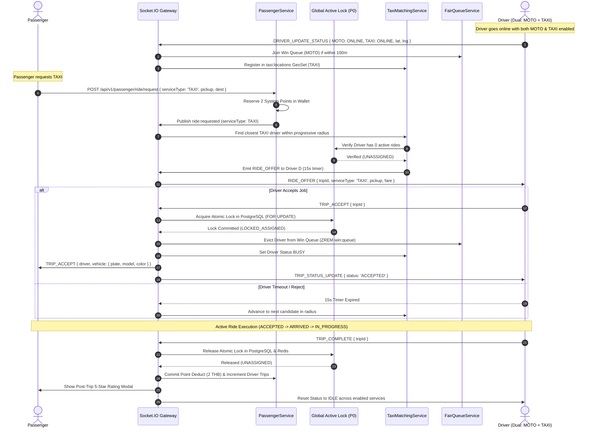

# GOZIPP Dual Mobility Target Architecture Specification
**Document ID:** GOZIPP-ARCH-01  
**Project:** GOZIPP Dual Mobility Platform (MOTO + TAXI)  
**Stage:** STAGE 1 — Architecture Finalization & Technical Contract Design  
**Status:** DRAFTED FOR APPROVAL  
**Architecture Principle:** Extend Existing Platform, Never Rebuild Without Evidence  
**Date:** 2026-11-08  

---

## 1. Architectural Vision & Scope

The GOZIPP Dual Mobility Platform extends the proven community motorcycle taxi infrastructure into a unified dual-service mobility platform supporting:

1. **GOZIPP MOTO:** Community Motorcycle Taxi ("วินมอเตอร์ไซค์") operating via localized Win station hubs and fair queueing.
2. **GOZIPP TAXI:** Car Taxi mobility operating via progressive geospatial proximity, supporting both:
   * **`PUBLIC_TAXI`:** Certified metered public yellow-plate taxis.
   * **`PRIVATE_CAR_FOR_HIRE`:** Legally registered and certified private vehicles operating under Thai Digital Platform Service regulations.

```
┌────────────────────────────────────────────────────────────────────────────────────────┐
│                                  GOZIPP PLATFORM CORE                                  │
│  ┌───────────────────────┐ ┌──────────────────────────┐ ┌───────────────────────────┐ │
│  │   Driver Identity     │ │     Passenger Identity   │ │    Security & Auth        │ │
│  │  - Single Account     │ │    - Phone, PIN, Profile │ │   - Firebase Phone Auth   │ │
│  │  - KYC / DLT Records  │ │    - Points Wallet (0% GP│ │   - Argon2id PIN + Pepper │ │
│  │  - Payout & Ratings   │ │    - Flat 2 THB Sys Fee  │ │   - HttpOnly JWT Cookies  │ │
│  └───────────┬───────────┘ └────────────┬─────────────┘ └─────────────┬─────────────┘ │
│              │                          │                             │               │
│              ▼                          ▼                             ▼               │
│  ┌──────────────────────────────────────────────────────────────────────────────────┐ │
│  │                       GLOBAL ACTIVE RIDE LOCK (P0 FOUNDATION)                    │ │
│  │    PostgreSQL Authoritative Unique Assignment + Redis Low-Latency Coordination   │ │
│  │       Rule: 1 Driver Account -> Max 1 Active Passenger Ride at Any Time          │ │
│  └──────────────────────────────────────┬───────────────────────────────────────────┘ │
│                                         │                                             │
│                    ┌────────────────────┴────────────────────┐                        │
│                    ▼                                         ▼                        │
│  ┌───────────────────────────────────┐     ┌───────────────────────────────────┐      │
│  │        MOTO SERVICE DOMAIN        │     │        TAXI SERVICE DOMAIN        │      │
│  │  - Vehicle: MOTORCYCLE            │     │  - Vehicles: PUBLIC_TAXI /        │      │
│  │  - Staging: Win Stations (100m)   │     │              PRIVATE_CAR_FOR_HIRE │      │
│  │  - Engine: FairQueueService (Lua) │     │  - Staging: Dynamic Cruising /    │      │
│  │  - Allocation: Win Rank Score     │     │             Designated Stands     │      │
│  │  - Geography: Localized Micro-zone│     │  - Engine: TaxiMatchingService    │      │
│  │  - Iconography: Scooter / Bike    │     │  - Allocation: Progressive Radius │      │
│  │  - Dispatch: Rank-based StationPop│     │  - Geography: Urban Macro-zone    │      │
│  │                                   │     │  - Iconography: Sedan / Cab       │      │
│  └───────────────────────────────────┘     └───────────────────────────────────┘      │
└────────────────────────────────────────────────────────────────────────────────────────┘
```

---

## 2. Core Architectural Principles (Non-Negotiable)

1. **Extend, Never Rebuild:**
   * All shared capabilities (Identity, JWT Auth, Argon2id PIN, Points System, Double-entry Ledger, Leaflet GPS rendering, Socket.IO gateway) are preserved 100% as verified in Stage 0.
   * No existing database tables are dropped or structurally compromised.
2. **0% Driver GP Commission Model Preserved:**
   * Drivers across both MOTO and TAXI retain 100% of the cash fare paid by passengers.
   * The platform collects only the flat, dynamic system fee in points (default: 2 points = 2 THB) deducted from the passenger wallet.
   * No mandatory driver in-app payment wallet or forced withdrawal system is introduced.
3. **Decoupled Service Domains:**
   * MOTO queues and TAXI dispatch pools are completely isolated in data structures, algorithms, and legal boundaries.
   * A car taxi driver cannot enter a motorcycle Win queue, and a motorcycle rider cannot be dispatched for a car taxi request.
4. **PostgreSQL as Authoritative Source of Truth:**
   * Active ride ownership and concurrency constraints are authoritatively enforced in PostgreSQL transactions. Redis acts as a high-speed telemetry and caching layer, never as the single point of truth for ride locks.

---

## 3. High-Level Subsystem Breakdown

### 3.1 Shared Core Subsystems
* **Authentication Subsystem (`packages/api/auth/`):**
  * Multi-role JWT tokens (roles: `PASSENGER`, `DRIVER`, `ADMIN`, `SUPERADMIN`, `SECURITY`, `AUDITOR`).
  * Refresh token rotation stored in `refresh_tokens`.
  * Public oracle protection with strict IP rate limiting (`ThrottlerGuard`).
* **Wallet & Pricing Subsystem (`packages/api/credit.service.ts`):**
  * Point Reservation pattern: `Reserve -> Commit Deduct / Release`.
  * Emergency overdraft limit management (default: -5 points).
  * Double-entry audit ledger entries (`ledger_entries`).
* **Realtime Hub (`packages/api/app.gateway.ts`):**
  * Socket.IO connected via `@socket.io/redis-adapter`.
  * Room topologies:
    * `user:<userId>` (Personal notification & job dispatch offers)
    * `trip:<tripId>` (Active ride telemetry, live GPS tracking, and two-way in-app chat)
    * `admin` (Operational God-view, fleet monitoring, and emergency SOS alerts)
* **GPS & Spatial Infrastructure (`packages/api/map.service.ts`):**
  * PostGIS spatial data types (`GEOMETRY(Point, 4326)`).
  * Spherical distance & ETA estimation via Haversine formula with Google Maps fallback.

---

### 3.2 Service Domain: GOZIPP MOTO (Motorcycle Taxi)
* **Target Fleet:** Registered motorcycle taxis belonging to recognized municipal stations ("วิน").
* **Physical Staging:** Defined geofenced station points (`stations` table) with radius typically 100 meters.
* **Matching Engine (`FairQueueService`):**
  * Drivers enter queue via atomic Redis Lua script calculating a Fairness Score:
    $$\text{Score} = (t_{\text{idle}} \times 0.5) + (t_{\text{recency}} \times 0.3) + \left(\frac{1}{\max(1, N_{\text{trips}})} \times 0.15\right) + (R_{\text{rating}} \times 0.05)$$
  * Dispatch pops the highest scoring driver from `win:<winId>:queue`.
  * 15-second response countdown with queue position penalty upon timeout/rejection.
* **Preservation Guarantee:** 100% of existing MOTO behavior is preserved with zero regression.

---

### 3.3 Service Domain: GOZIPP TAXI (Car Taxi)
* **Target Fleet:**
  1. `PUBLIC_TAXI`: Certified yellow-plate metered taxis with public transport licenses.
  2. `PRIVATE_CAR_FOR_HIRE`: Eligible private cars registered under Thai Digital Platform regulations with DLT certification stickers and commercial ride-hailing insurance.
* **Physical Staging:** Roaming/cruising along arterial corridors, staging at designated taxi stands, or home standby.
* **Matching Engine (`TaxiMatchingService`):**
  * Independent from Win station queues.
  * Uses **Progressive Geospatial Radius Search** (Step 1: 1.5 km -> Step 2: 3.0 km -> Step 3: 5.0 km / configurable max).
  * Dispatches sequential 15-second job offers to the closest available certified vehicle.
  * Rejection or timeout shifts the offer to the next closest candidate without affecting MOTO Win queue scores.

---

## 4. End-to-End System Architecture Diagram



---

## 5. Architectural Quality Attributes & Non-Functional Guarantees

| Quality Attribute | Architectural Guarantee | Verification Method |
| :--- | :--- | :--- |
| **Concurrency Safety** | Exactly one active ride per driver across all services. Impossible to accept two jobs simultaneously. | PostgreSQL atomic transaction (`FOR UPDATE`) + Redis `SET NX` low-latency barrier. |
| **Backward Compatibility** | Existing motorcycle riders and passengers experience zero disruption or workflow degradation. | Existing endpoints default to `serviceType = 'MOTO'`. Existing DDL is preserved. |
| **Zero GP Compliance** | 100% of fare is retained by the driver in cash/PromptPay. Platform takes 0% commission. | Enforced in ledger contracts and driver screens (no fare deductions). |
| **Regulatory Compliance** | Unverified or expired vehicles are programmatically blocked from receiving passenger dispatches. | Mandatory release gate in dispatch router verifying `verification_status === 'VERIFIED'`. |
| **Fault Resilience** | Server crash or Redis restart does not lose active trip state or create lock deadlocks. | State restored on boot from PostgreSQL; locks have safety TTL (3 hours) and heartbeat reconciliation. |
