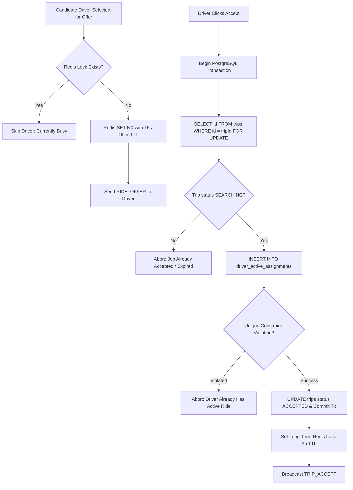

# GOZIPP Global Active Ride Lock Specification (P0 Concurrency Foundation)
**Document ID:** GOZIPP-LOCK-01  
**Project:** GOZIPP Dual Mobility Platform (MOTO + TAXI)  
**Stage:** STAGE 1 — Technical Contract Design  
**Status:** DRAFTED FOR APPROVAL  
**Priority:** P0 (Foundational Concurrency Architecture)  
**Date:** 2026-11-08  

---

## 1. Problem Statement & Invariant Guarantee

In GOZIPP Dual Mobility, a single driver account can enable **both MOTO and TAXI simultaneously**. This introduces the risk of cross-service double-booking:

```
Scenario:
10:00:00.000 -> Driver Somchai is ONLINE on both MOTO and TAXI.
10:00:01.100 -> A passenger nearby requests GOZIPP MOTO -> Gateway dispatches RIDE_OFFER #A to Somchai.
10:00:01.150 -> Another passenger requests GOZIPP TAXI -> Gateway dispatches RIDE_OFFER #B to Somchai.
10:00:02.000 -> Somchai taps "รับงาน" on both mobile prompts within milliseconds.
```

### The System Invariant
$$\forall d \in \text{Drivers}, \quad \sum \text{ActiveRides}(d) \le 1$$
**Under no circumstance may a driver hold more than ONE active passenger assignment across all mobility services.**

---

## 2. Why Redis Cannot Be the Sole Source of Truth (Mandatory Correction C)

While Redis is exceptionally fast for caching and pub/sub, relying exclusively on Redis for active ride locks creates critical failure modes:

| Failure Mode | Redis-Only Vulnerability | Dual-Tier PostgreSQL Defense |
| :--- | :--- | :--- |
| **Server Restart / Crash** | In-memory keys are lost if Redis restarts before persistence (AOF/RDB sync interval). Drivers could accept duplicate jobs. | PostgreSQL WAL guarantees ACID durability; active locks survive process crashes. |
| **Network Partition (Split-Brain)** | Redis cluster failover can acknowledge locks on partitioned nodes, allowing duplicate assignments. | PostgreSQL enforces serialized transactions and unique constraints at the database master. |
| **Memory Eviction** | Under high memory pressure, Redis key eviction policies (`allkeys-lru`) can silently evict active lock keys. | PostgreSQL tables never evict rows under memory pressure. |

---

## 3. Two-Tier Concurrency Architecture

GOZIPP implements a **Two-Tier Concurrency Architecture**:
1. **Tier 1 (Authoritative System of Record):** PostgreSQL 15+ database transaction with row-level locks and strict table-level unique constraints.
2. **Tier 2 (High-Speed Coordination Cache):** Redis in-memory atomic keys (`SET NX`) for low-latency pre-dispatch candidate filtering.



---

## 4. Authoritative PostgreSQL Implementation Contract

### 4.1 Database Table & Constraint Schema
* Table: `driver_active_assignments`
* Unique Constraint: `CONSTRAINT uq_active_assignment_driver UNIQUE (driver_id)`

```sql
-- PostgreSQL DDL:
CREATE TABLE IF NOT EXISTS driver_active_assignments (
  id              UUID PRIMARY KEY DEFAULT uuid_generate_v4(),
  driver_id       UUID NOT NULL REFERENCES drivers(id) ON DELETE CASCADE,
  trip_id         UUID NOT NULL REFERENCES trips(id) ON DELETE CASCADE,
  service_type    VARCHAR(20) NOT NULL CHECK (service_type IN ('MOTO', 'TAXI')),
  vehicle_id      UUID NOT NULL REFERENCES driver_vehicles(id),
  acquired_at     TIMESTAMPTZ NOT NULL DEFAULT NOW(),
  lock_state      VARCHAR(20) NOT NULL DEFAULT 'ACTIVE',

  CONSTRAINT uq_active_assignment_driver UNIQUE (driver_id),
  CONSTRAINT uq_active_assignment_trip UNIQUE (trip_id)
);
```

### 4.2 TypeORM Atomic Transaction Implementation (`packages/api/driver.service.ts`)
```typescript
async acceptTrip(dto: TripActionDto): Promise<AcceptTripResult> {
  const queryRunner = this.dataSource.createQueryRunner();
  await queryRunner.connect();
  await queryRunner.startTransaction('SERIALIZABLE');

  try {
    // 1. Authoritative Row Lock on Trip
    const trip = await queryRunner.manager
      .createQueryBuilder(TripEntity, 'trip')
      .setLock('pessimistic_write')
      .where('trip.id = :tripId', { tripId: dto.tripId })
      .getOne();

    if (!trip || !['SEARCHING', 'SCHEDULED'].includes(trip.status)) {
      throw new BadRequestException('งานนี้หมดอายุหรือมีคนรับไปแล้ว');
    }

    // 2. Fetch Active Service Vehicle
    const serviceProfile = await queryRunner.manager.findOne(DriverServiceProfileEntity, {
      where: { driver_id: dto.driverId, service_type: trip.service_type as any, is_enabled: true }
    });

    if (!serviceProfile || !serviceProfile.active_vehicle_id) {
      throw new BadRequestException('ไม่พบพาหนะที่เปิดใช้งานสำหรับบริการนี้');
    }

    // 3. Atomically Insert Global Active Assignment (Fails on duplicate driver_id)
    const assignment = queryRunner.manager.create(DriverActiveAssignmentEntity, {
      driver_id: dto.driverId,
      trip_id: trip.id,
      service_type: trip.service_type as any,
      vehicle_id: serviceProfile.active_vehicle_id,
      lock_state: 'ACTIVE',
    });

    try {
      await queryRunner.manager.save(assignment);
    } catch (dbErr: any) {
      if (dbErr.code === '23505') { // PostgreSQL unique_violation
        throw new ConflictException('ท่านมีงานที่กำลังดำเนินการอยู่แล้ว ไม่สามารถรับงานซ้อนได้');
      }
      throw dbErr;
    }

    // 4. Update Trip & Driver Statuses in same atomic transaction
    trip.driver_id = dto.driverId;
    trip.vehicle_id = serviceProfile.active_vehicle_id;
    trip.status = 'ACCEPTED';
    trip.accepted_at = new Date();
    await queryRunner.manager.save(trip);

    await queryRunner.manager.update(DriverEntity, dto.driverId, { current_status: 'BUSY' });
    await queryRunner.manager.update(DriverServiceProfileEntity, 
      { driver_id: dto.driverId }, 
      { availability_status: 'ONLINE_BUSY' }
    );

    // Commit PostgreSQL Transaction
    await queryRunner.commitTransaction();

    // 5. Update Redis Caching & Queue State
    await this.redis.set(`driver:${dto.driverId}:active_ride`, `${trip.id}:${trip.service_type}`, 'EX', 10800);
    const winId = await this.redis.hget(`driver:${dto.driverId}:stats`, 'currentWin');
    if (winId) {
      await this.fairQueueService.evictDriver(winId, dto.driverId);
    }

    return { success: true, tripId: trip.id, passengerId: trip.passenger_id };
  } catch (error) {
    await queryRunner.rollbackTransaction();
    throw error;
  } finally {
    await queryRunner.release();
  }
}
```

---

## 5. Atomic Lock Release Specification

The Global Active Ride Lock is released **ONLY** when a trip reaches a verified terminal state (`COMPLETED` or `CANCELLED`):

```typescript
async releaseActiveLock(driverId: string, tripId: string, queryRunner?: QueryRunner): Promise<void> {
  const runner = queryRunner || this.dataSource.createQueryRunner();
  const isLocalRunner = !queryRunner;
  if (isLocalRunner) {
    await runner.connect();
    await runner.startTransaction();
  }

  try {
    // 1. Delete Authoritative Lock Row in PostgreSQL
    await runner.manager.delete(DriverActiveAssignmentEntity, {
      driver_id: driverId,
      trip_id: tripId,
    });

    // 2. Re-enable Driver Availability
    await runner.manager.update(DriverEntity, driverId, { current_status: 'IDLE' });
    await runner.manager.update(DriverServiceProfileEntity, 
      { driver_id: driverId, is_enabled: true }, 
      { availability_status: 'ONLINE_IDLE' }
    );

    if (isLocalRunner) await runner.commitTransaction();

    // 3. Clear Redis Fast-Path Cache
    await this.redis.del(`driver:${driverId}:active_ride`);
  } catch (err) {
    if (isLocalRunner) await runner.rollbackTransaction();
    throw err;
  } finally {
    if (isLocalRunner) await runner.release();
  }
}
```

---

## 6. Deadlock & Race Condition Defenses

1. **Simultaneous Acceptance Race:**
   * PostgreSQL unique index `uq_active_assignment_driver` guarantees that even if two requests hit the database simultaneously, one commits and the second immediately rolls back with HTTP 409 Conflict.
2. **Re-connection & State Recovery:**
   * Upon client socket reconnection, the server queries `driver_active_assignments`.
   * If a record exists, the server immediately re-hydrates the active ride room and pushes `STATE_RESTORED` to the mobile client.
3. **Safety Timeout (TTL Safeguard):**
   * If a driver’s phone loses connectivity or crashes mid-trip, the Redis lock has a 3-hour TTL (`EX 10800`).
   * A periodic background reconciliation job scans `driver_active_assignments` for trips older than 6 hours without GPS telemetry and alerts the operations center via the Admin SOS panel.
