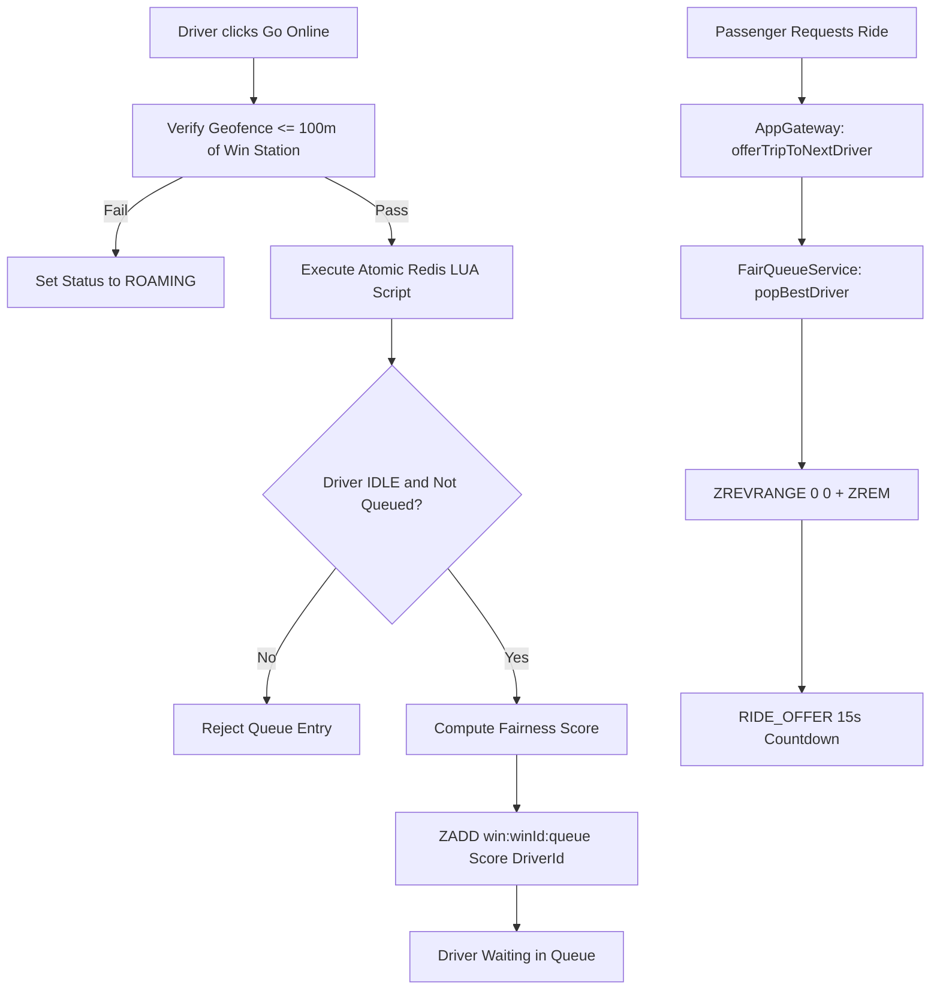

# GOZIPP Queue & Matching Algorithm Audit
**Document ID:** GOZIPP-AUDIT-05  
**Project:** GOZIPP Dual Mobility Platform  
**Stage:** STAGE 0 — Read-Only Queue & Matching Audit  
**Status:** COMPLETE & VERIFIED AGAINST SOURCE CODE  
**Audit Date:** 2026-11-08  

---

## 1. Existing Fair Queue Architecture (`packages/api/fair-queue.service.ts`)

GOZIPP currently implements a proprietary **Fair Queue System** specifically engineered for physical Motorcycle Taxi Stations ("วินมอเตอร์ไซค์").



### 1.1 Mathematical Formulation of Queue Scoring
* **Code Reference:** `packages/api/fair-queue.service.ts` L5-10 & L89-100:
  $$\text{Fixed Score} = (\Delta t_{\text{last}} \times 0.3) + \left(\frac{1}{\max(1, N_{\text{today}})} \times 0.15\right) + (R \times 0.05)$$
  $$\text{Final ZSet Score} = \text{Fixed Score} - (t_{\text{entry}} \times 0.5)$$

Where:
* $t_{\text{entry}}$: Timestamp when driver joined the queue (Weights.IDLE = 0.5 — gives priority to drivers who have waited longer).
* $\Delta t_{\text{last}}$: Elapsed seconds since the driver's last completed trip (Weights.RECENCY = 0.3).
* $N_{\text{today}}$: Number of trips completed today (Weights.TRIPS = 0.15 — equalizes daily earnings across drivers).
* $R$: Driver average star rating (Weights.RATING = 0.05).

### 1.2 Redis Data Structures Used
* `win:<winId>:queue`: Redis **Sorted Set (ZSET)**. Member: `driverId`, Score: `finalZSetScore`.
* `driver:<driverId>:stats`: Redis **Hash (HSET)**. Keys: `lastTripTime`, `tripsToday`, `rating`, `status`, `currentWin`, `joinedQueueAt`.
* `drivers:locations`: Redis **GeoSet (GEOADD)**. Member: `driverId`, Coordinates: `(longitude, latitude)`.

### 1.3 Dispatching & Pop Semantics (`popBestDriver`)
* **Code Reference:** `fair-queue.service.ts` L115-136:
  * Queries top driver: `ZREVRANGE win:<winId>:queue 0 0`.
  * Atomically removes: `ZREM win:<winId>:queue <bestDriverId>`.
  * Concurrency guard: If `popped !== 1`, re-executes recursively to prevent two concurrent ride requests from dispatching the same driver.
  * Timeout penalty: If driver fails to accept within 15 seconds, `handleTimeout(winId, driverId)` re-inserts them into the queue with reset idle time.

---

## 2. Incompatibility Analysis: Why Taxi Cannot Use the Win Queue

| Architecture Dimension | Motorcycle Taxi (GOZIPP MOTO) | Car Taxi (GOZIPP TAXI) | Conflict Analysis |
| :--- | :--- | :--- | :--- |
| **Operational Staging** | Fixed physical stands ("วิน") on street corners, soi entrances, BTS/MRT stations. | Cruising/roaming along main roads, airport stands, or parked in residential zones. | Taxis do not belong to motorcycle Win stations and cannot physically queue at a motorcycle stand. |
| **Geofence Radius** | **100 meters** (`radius_m: 100`). Driver must be physically inside the Win to queue. | **3,000 to 5,000 meters** (3–5 km). Dispatch operates over a regional radius. | A 100m geofence check would permanently fail for roaming taxis. |
| **Job Allocation Paradigm** | **Rank-based Fair Station Queue** (First-in / fair score at specific station). | **Proximity & Roaming ETA Match** (Nearest available vehicle or broadcast radius). | Mixing taxi drivers into `win:queue` would send car drivers on motorcycle jobs down 1-meter wide pedestrian alleys. |
| **Legal Regulation** | DLT Motorcycle Public Taxi regulations (Yellow vest, registered Win territory). | DLT Public Taxi & App-based Private Vehicle regulations (Chor/Mor license, GPS tracking). | Operating a taxi under a motorcycle Win license violates Department of Land Transport regulations. |

---

## 3. Dual Mobility Target Matching Architecture

To support both MOTO and TAXI without breaking existing motorcycle queues, the matching layer will be decoupled into two independent matching engines coordinated by a shared dispatch router:

```
                                  Passenger Ride Request
                                            │
                                            ▼
                           ┌─────────────────────────────────┐
                           │      Dispatch Service Router     │
                           │   (Inspects trip.service_type)   │
                           └─────────────────────────────────┘
                                            │
                    ┌───────────────────────┴───────────────────────┐
                    ▼                                               ▼
         [ service_type === 'MOTO' ]                     [ service_type === 'TAXI' ]
                    │                                               │
                    ▼                                               ▼
       ┌────────────────────────┐                      ┌────────────────────────┐
       │   FairQueueService     │                      │   TaxiMatchingService   │
       │  (Motorcycle Station)  │                      │   (Geospatial Radius)  │
       └────────────────────────┘                      └────────────────────────┘
                    │                                               │
           ZSET win:winId:queue                            Redis GEOSEARCH / PostGIS
                    │                                      (Radius 3-5 km, IDLE only)
                    ▼                                               ▼
        Pop Best Station Rider                            Select Best Proximity Cab
                    │                                               │
                    └───────────────────────┬───────────────────────┘
                                            ▼
                           ┌─────────────────────────────────┐
                           │    Global Active Ride Lock      │
                           │  Verify Driver has 0 active     │
                           │  rides across ALL service types │
                           └─────────────────────────────────┘
                                            │
                                            ▼
                                  Emit RIDE_OFFER (15s)
```

### 3.1 Taxi Matching Engine Design (`TaxiMatchingService`)
1. **Candidate Discovery:**
   * When a passenger requests a TAXI, the system queries available taxi drivers within a 3.0 km radius:
     ```redis
     GEOSEARCH taxi:locations FROMLONLAT <pickupLng> <pickupLat> BYRADIUS 3.0 KM ASC WITHDIST
     ```
2. **Eligibility Filtering:**
   * Validates driver is `IDLE` in `driver_service_profiles` for `TAXI`.
   * Validates vehicle is `VERIFIED` and matches requested car category (`PUBLIC_TAXI` or `PRIVATE_CAR_FOR_HIRE`).
   * Validates driver has NO active ride across any service type.
3. **Offer Dispatching:**
   * Sequentially offers the ride to candidate drivers with the shortest ETA (15-second response window).
   * If driver rejects or times out, immediately offers to the next candidate in the proximity list.
   * If no driver accepts within 60 seconds, returns `TIMEOUT_NO_DRIVER`.

---

## 4. Multi-Service Availability Isolation Guarantees

1. **Queue Independence:**
   * MOTO drivers only appear in `win:${winId}:queue`.
   * TAXI drivers only appear in `taxi:locations` (Redis GeoSet).
   * A dual-registered driver who is online for both services will exist in `win:${winId}:queue` (for MOTO) AND `taxi:locations` (for TAXI) simultaneously.
2. **Zero Queue Pollution:**
   * The MOTO queue pop operation will NEVER return a car-only vehicle.
   * The TAXI radius search will NEVER return a motorcycle vehicle.
3. **Queue Eviction on Cross-Service Job Acceptance:**
   * If a dual-registered driver accepts a TAXI trip:
     * System commits `driver_service_profiles.status = 'BUSY'`.
     * System removes the driver from their active Win queue: `ZREM win:${winId}:queue ${driverId}`.
     * System acquires the Global Active Ride Lock.
   * When the TAXI trip finishes, the driver may re-enter the Win queue upon returning to the Win geofence.
