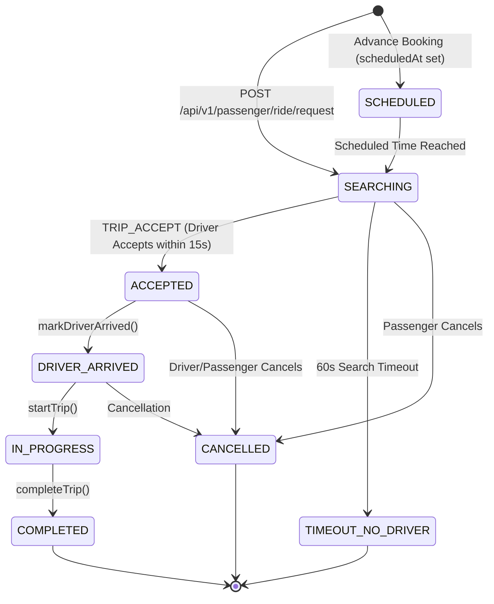

# GOZIPP Ride State Machine & Concurrency Audit
**Document ID:** GOZIPP-AUDIT-06  
**Project:** GOZIPP Dual Mobility Platform  
**Stage:** STAGE 0 — Read-Only State Machine & Concurrency Audit  
**Status:** COMPLETE & VERIFIED AGAINST SOURCE CODE  
**Audit Date:** 2026-11-08  

---

## 1. Existing Ride State Machine

The trip lifecycle is governed by strict state transitions enforced on both the PostgreSQL database (`TripEntity.status`) and the Redis in-memory cache (`trip:${tripId}`).



### 1.1 State Transition Enforcement Matrix

| From State | Allowed Target State | Trigger Function / API | Validation Evidence |
| :--- | :--- | :--- | :--- |
| **`SEARCHING`** | `ACCEPTED` | `driverService.acceptTrip()` | Verifies `trip.status in ('SEARCHING', 'SCHEDULED')` ([`driver.service.ts` L269](file:///c:/Users/acer/Videos/Project/Gozipp/packages/api/driver.service.ts#L269)) |
| **`SEARCHING`** | `CANCELLED` | `passengerService.cancelRide()` | Verifies trip exists and passenger is owner ([`passenger.service.ts` L599](file:///c:/Users/acer/Videos/Project/Gozipp/packages/api/passenger.service.ts#L599)) |
| **`SEARCHING`** | `TIMEOUT_NO_DRIVER` | `passengerService.setupTimeout()` | Fired after 60 seconds if no driver accepts |
| **`SCHEDULED`** | `ACCEPTED` | `driverService.acceptTrip()` | Allowed if driver is `preferred_driver_id` |
| **`ACCEPTED`** | `DRIVER_ARRIVED` | `driverService.markDriverArrived()` | Requires `trip.status === 'ACCEPTED'` ([`driver.service.ts` L326](file:///c:/Users/acer/Videos/Project/Gozipp/packages/api/driver.service.ts#L326)) |
| **`DRIVER_ARRIVED`** | `IN_PROGRESS` | `driverService.startTrip()` | Requires `trip.status === 'DRIVER_ARRIVED'` ([`driver.service.ts` L336](file:///c:/Users/acer/Videos/Project/Gozipp/packages/api/driver.service.ts#L336)) |
| **`IN_PROGRESS`** | `COMPLETED` | `driverService.completeTrip()` | Requires `status in ('DRIVER_ARRIVED', 'IN_PROGRESS', 'ACCEPTED')` ([`driver.service.ts` L439](file:///c:/Users/acer/Videos/Project/Gozipp/packages/api/driver.service.ts#L439)) |
| **Terminal States** | None | Terminal (`COMPLETED`, `CANCELLED`, `TIMEOUT_NO_DRIVER`) | **Immutable:** No further transitions permitted |

### 1.2 Automated State Regression Test
The state transitions are validated by automated unit tests in [`packages/api/test/trip-lifecycle.test.cjs`](file:///c:/Users/acer/Videos/Project/Gozipp/packages/api/test/trip-lifecycle.test.cjs), asserting that out-of-order transitions throw `BadRequestException`.

---

## 2. Existing Concurrency & Race Condition Mitigations

1. **Trip Offer Lock (`dispatch:${tripId}:lock`):**
   * Key: `dispatch:${tripId}:lock` (TTL: 10s, `NX` flag).
   * Prevents multiple gateway workers from offering the same trip to two drivers simultaneously ([`app.gateway.ts` L70](file:///c:/Users/acer/Videos/Project/Gozipp/packages/api/app.gateway.ts#L70)).
2. **Trip Acceptance Lock (`trip:${tripId}:lock`):**
   * Key: `trip:${tripId}:lock` (TTL: 30s, `NX` flag).
   * Value: `driverId`.
   * Guarantees that if two drivers attempt to accept the same trip simultaneously, only the first transaction succeeds; the second receives HTTP 400 (`งานนี้หมดอายุหรือมีคนรับไปแล้ว`) ([`driver.service.ts` L264](file:///c:/Users/acer/Videos/Project/Gozipp/packages/api/driver.service.ts#L264)).
3. **Queue Pop Atomicity:**
   * Uses Redis `ZREM` immediately following `ZREVRANGE` to guarantee that popped drivers cannot be popped twice ([`fair-queue.service.ts` L127](file:///c:/Users/acer/Videos/Project/Gozipp/packages/api/fair-queue.service.ts#L127)).

---

## 3. The Global Active Ride Lock Specification

In Dual Mobility, a single driver account can enable MOTO and TAXI simultaneously. However, **a driver may only have ONE active passenger ride at a time across all service types**.

### 3.1 Concurrency Policy Matrix

| Driver State | Incoming MOTO Request | Incoming TAXI Request | Backend Action |
| :--- | :---: | :---: | :--- |
| **MOTO IDLE + TAXI IDLE** | Available | Available | Eligible for both MOTO and TAXI dispatch. |
| **MOTO ACTIVE RIDE** | Blocked | Blocked | Skip driver during TAXI radius search; drop MOTO offers. |
| **TAXI ACTIVE RIDE** | Blocked | Blocked | Skip driver during MOTO queue pop; drop TAXI offers. |
| **RIDE COMPLETED** | Released | Released | Atomically release lock; driver becomes eligible for both. |
| **RIDE CANCELLED** | Released | Released | Atomically release lock upon confirmed terminal state. |

### 3.2 Backend Implementation Architecture

The Global Active Ride Lock will be implemented using a dual-layer strategy:

#### Layer 1: Atomic Redis Active Ride Lock
Before offering or accepting any trip, the backend checks and sets:
```redis
SET driver:${driverId}:active_ride "${tripId}:${serviceType}" EX 10800 NX
```
* `NX`: Ensures atomicity. Fails immediately if the driver already holds an active lock.
* `EX 10800`: 3-hour safety timeout to prevent permanent deadlocks in case of server crashes.

#### Layer 2: PostgreSQL Active Ride Constraint (Atomic Database Transaction)
Inside `acceptTrip()`, a TypeORM transaction executes:
```sql
-- Atomically verify no active trip exists for this driver
SELECT id FROM trips 
WHERE driver_id = $1 
  AND status IN ('ACCEPTED', 'DRIVER_ARRIVED', 'IN_PROGRESS')
FOR UPDATE;
```
If any active trip is returned, the acceptance transaction rolls back with:
```typescript
throw new BadRequestException('คนขับมีงานที่กำลังดำเนินการอยู่แล้ว ไม่สามารถรับงานซ้อนได้');
```

#### Layer 3: Atomic Lock Release
Upon trip completion or cancellation, the release executes:
```typescript
// In driver.service.ts completeTrip() & cancelRide()
await this.redis.del(`driver:${driverId}:active_ride`);
await this.driverRepo.update(driverId, { current_status: 'IDLE' });
// Re-enable availability across enabled services
await this.driverServiceProfileRepo.update(
  { driverId, isEnabled: true },
  { currentStatus: 'IDLE' }
);
```
