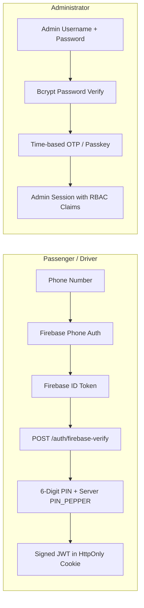

# GOZIPP Security & Compliance Audit
**Document ID:** GOZIPP-AUDIT-07  
**Project:** GOZIPP Dual Mobility Platform  
**Stage:** STAGE 0 — Read-Only Security & Compliance Audit  
**Status:** COMPLETE & VERIFIED AGAINST SOURCE CODE  
**Audit Date:** 2026-11-08  

---

## 1. Authentication Boundaries

The GOZIPP authentication architecture implements defense-in-depth across passengers, drivers, and administrators:

### 1.1 Token Lifecycle & Storage
* **Access Token:** JWT signed with `JWT_SECRET` (Production validates length $\ge 64$ characters). Expiration is strictly limited to **1 hour** ([`packages/api/app.module.ts` L77](file:///c:/Users/acer/Videos/Project/Gozipp/packages/api/app.module.ts#L77)).
* **Token Storage:** Delivered via **HttpOnly, Secure, SameSite=Lax** cookies (`access_token`, `refresh_token`) via `setAuthCookies()` ([`packages/api/common/cookie.util.ts`](file:///c:/Users/acer/Videos/Project/Gozipp/packages/api/common/cookie.util.ts)), mitigating Cross-Site Scripting (XSS) token exfiltration.
* **Refresh Token Rotation:** Refresh tokens are hashed and persisted in the `refresh_tokens` table. Upon refresh, the old token is revoked, preventing replay attacks.
* **PIN Hashing:** PINs are hashed using **Argon2id** with a server-side pepper `PIN_PEPPER` ($\ge 32$ characters) ([`packages/api/common/pin-crypto.ts`](file:///c:/Users/acer/Videos/Project/Gozipp/packages/api/common/pin-crypto.ts)).

---

## 2. Role-Based Access Control (RBAC)

* **Enforcement:** Global `AuthGuard` paired with `@UseGuards(RolesGuard)` and `@Roles(...)` decorators.
* **Roles Hierarchy:**
  1. `PASSENGER`: Access to passenger booking, wallet, ride history, rating.
  2. `DRIVER`: Access to driver online status, queue, job acceptance, trip actions.
  3. `ADMIN`: Access to fleet management, queue overrides, driver/vehicle approvals.
  4. `SECURITY`: Access to fraud anomalies, SOS alerts, audit logs.
  5. `SUPERADMIN`: Unrestricted platform administration and configuration.
  6. `AUDITOR`: Read-only reporting and audit compliance access.

---

## 3. Upload & Document Security

Driver and vehicle compliance verification requires uploading national IDs, driver licenses, and vehicle registration books:
* **Code Reference:** [`packages/api/common/upload.controller.ts`](file:///c:/Users/acer/Videos/Project/Gozipp/packages/api/common/upload.controller.ts) & [`file-validation.ts`](file:///c:/Users/acer/Videos/Project/Gozipp/packages/api/common/file-validation.ts)
* **Security Controls:**
  1. **MIME Type Whitelist:** Restricted strictly to `image/jpeg`, `image/png`, `image/webp`, and `application/pdf`.
  2. **File Size Limit:** Capped at 5 MB per file upload.
  3. **Filename Randomization:** Uploaded files are renamed using cryptographically secure UUIDs (`uuid_generate_v4()`) to prevent directory traversal (`../`) and file overwrite attacks.
  4. **Non-Executable Serving:** Upload directories are NOT statically mounted. Files are streamed with `X-Content-Type-Options: nosniff` and non-executable headers.

---

## 4. Location Privacy & Data Protection

* **Driver Location Privacy:**
  * Driver coordinates are stored temporarily in Redis GeoSet `drivers:locations` with TTL.
  * Live location broadcasts (`DRIVER_LOCATION_UPDATE`) are published ONLY to the authenticated Socket.IO room `trip:${tripId}`. Unrelated passengers cannot track drivers.
* **Passenger Location Privacy:**
  * Pickup and destination coordinates are only accessible by the assigned driver after `TRIP_ACCEPT`.

---

## 5. Security Audit Logging

* **Code Reference:** [`packages/api/common/audit-log.service.ts`](file:///c:/Users/acer/Videos/Project/Gozipp/packages/api/common/audit-log.service.ts)
* **Database Table:** `audit_logs` (Columns: `id`, `user_id`, `user_type`, `action`, `resource`, `resource_id`, `ip_address`, `metadata`, `created_at`).
* **Audited Actions:**
  * Driver approval (`DRIVER_APPROVED`) / Driver rejection (`DRIVER_REJECTED`)
  * Driver suspension (`DRIVER_SUSPENDED`)
  * Manual queue override (`QUEUE_OVERRIDE`)
  * Configuration changes (`CONFIG_CHANGED`)
  * Daily financial close (`DAILY_CLOSE`)
* **Dual Mobility Audit Requirement:**
  * Every vehicle verification decision (`VEHICLE_VERIFIED`, `VEHICLE_REJECTED`, `VEHICLE_SUSPENDED`) must be recorded in `audit_logs` with actor ID, reviewer comments, and document references.
