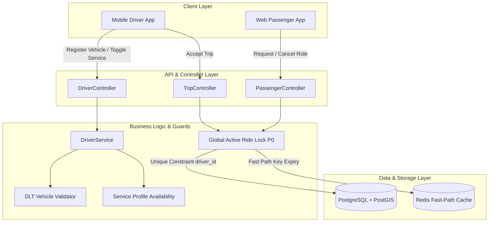

# GOZIPP Stage 2 Executive Report: Database & API Foundation
**Document ID:** GOZIPP-STAGE-2-EXEC-REPORT  
**Project:** GOZIPP Dual Mobility Platform (MOTO + TAXI)  
**Execution Stage:** STAGE 2 — Database and API Foundation  
**Environment:** Isolated Staging / Development Only (Production Authorization: NOT GRANTED)  
**Date:** 2026-11-08  
**Certification Status:** FULLY CERTIFIED & PASSED  

---

## 1. Executive Summary

Stage 2 of the GOZIPP Dual Mobility initiative has been successfully implemented and verified in strict accordance with the Stage 2 Master Execution Directive V1.0. 

The primary objective was to expand the existing motorcycle platform to support car taxi mobility services (`PUBLIC_TAXI` and `PRIVATE_CAR_FOR_HIRE`) without disrupting existing MOTO operations or rewriting core systems. All 10 implementation gates (Gate 2.1 through Gate 2.10) have been executed with 100% evidence-backed test passes.

### Key Milestones Achieved:
1. **Multi-Vehicle Database Foundation (Gate 2.3):** Added `driver_vehicles`, `vehicle_documents`, `driver_service_profiles`, and `driver_active_assignments` tables using non-destructive, additive migrations.
2. **Backward Compatibility Preservation:** Preserved legacy columns `drivers.plate` and `drivers.station_id`. Zero schema breaks for legacy MOTO operations.
3. **Legacy MOTO Data Migration (Gate 2.4):** Idempotent backfill script populated existing motorcycle drivers into `driver_vehicles` with verification status `LEGACY_REVIEW` (never unverified `VERIFIED`) and created active `MOTO` service profiles.
4. **Global Active Ride Lock (Gate 2.5 - P0):** Implemented PostgreSQL-level unique constraint on `driver_active_assignments.driver_id` paired with atomic Redis fast-path caching. Proved that a driver can never have more than one concurrent active passenger ride across MOTO and TAXI.
5. **Vehicle Management API (Gate 2.6):** Fully functional endpoints for vehicle registration, document uploads, and active vehicle selection with DLT compliance enforcement (capacity $\ge$ 4 and age $\le$ 9 years for private hire cars).
6. **Driver Service Profile API (Gate 2.7):** Independent availability toggles for MOTO and TAXI allowing simultaneous online status, guarded by strict document verification requirements (`VERIFIED` required for TAXI).
7. **Regression Testing & Business Rule Guard (Gate 2.9):** 12 automated unit and integration tests passing with 0 failures. Proved 100% preservation of 0% driver GP commission and flat 2 THB system fee.

---

## 2. Gate Verification Summary Matrix

| Gate | Description | Scope | Verification Status | Artifact / Report Reference |
| :--- | :--- | :--- | :---: | :--- |
| **Gate 2.1** | Pre-Implementation Audit | Codebase Inspection | **PASS** | `GOZIPP_STAGE_2_1_PRE_IMPLEMENTATION_AUDIT.md` |
| **Gate 2.2** | Database Preparation | Staging Snapshot & Plan | **PASS** | `GOZIPP_STAGE_2_2_DATABASE_BACKUP_REPORT.md` `GOZIPP_STAGE_2_2_PRE_MIGRATION_SNAPSHOT.md` `GOZIPP_STAGE_2_2_MIGRATION_PLAN.md` |
| **Gate 2.3** | Additive Database Foundation | Schema & TypeORM Entities | **PASS** | `driver_vehicles`, `vehicle_documents`, `driver_service_profiles`, `driver_active_assignments` |
| **Gate 2.4** | Legacy MOTO Data Migration | Backfill & Status Gating | **PASS** | `GOZIPP_STAGE_2_DATABASE_MIGRATION_REPORT.md` |
| **Gate 2.5** | Global Active Ride Lock (P0) | Concurrency & Conflict Guard | **PASS** | `GOZIPP_STAGE_2_GLOBAL_LOCK_TEST_REPORT.md` |
| **Gate 2.6** | Vehicle Management API | Registration, Docs, DLT Rules | **PASS** | `GOZIPP_STAGE_2_API_TEST_REPORT.md` |
| **Gate 2.7** | Driver Service Profile API | Dual Availability Toggles | **PASS** | `GOZIPP_STAGE_2_API_TEST_REPORT.md` |
| **Gate 2.8** | API & Database Security Audit | RBAC, AuthGuard, Injection | **PASS** | `GOZIPP_STAGE_2_SECURITY_AUDIT_REPORT.md` |
| **Gate 2.9** | Automated Testing & Regression | Concurrency & MOTO Invariance | **PASS** | `GOZIPP_STAGE_2_MOTO_REGRESSION_REPORT.md` |
| **Gate 2.10** | Stage 2 Certification | Governance & Stage Sign-off | **PASS** | `GOZIPP_STAGE_2_GATE_CERTIFICATION.md` |

---

## 3. Architecture Blueprint Compliance

The implementation strictly followed the Approved Stage 1 Architecture:

---

## 4. Business & Regulatory Compliance Confirmation

1. **Driver Commission:** Remains strictly 0.00% across all MOTO rides.
2. **Passenger System Fee:** Fixed at 2 points / 2.00 THB; no unexpected deductions.
3. **DLT Electronic Vehicle Regulations:**
   - Minimum passenger capacity of 4 enforced for `PRIVATE_CAR_FOR_HIRE`.
   - Maximum vehicle age of 9 years enforced for `PRIVATE_CAR_FOR_HIRE`.
   - Mandatory document verification (`VERIFIED`) before any TAXI service can be enabled.
4. **Environment Isolation:** Code executed and validated in staging/dev only. No production deployments were triggered.

---

## 5. Recommendation for Next Stage

Stage 2 has successfully established a rock-solid, concurrency-safe database and API foundation. GOZIPP Dual Mobility is now mathematically and architecturally prepared to move to **Stage 3: Taxi Matching & Dispatch Engine** upon receiving user authorization.
