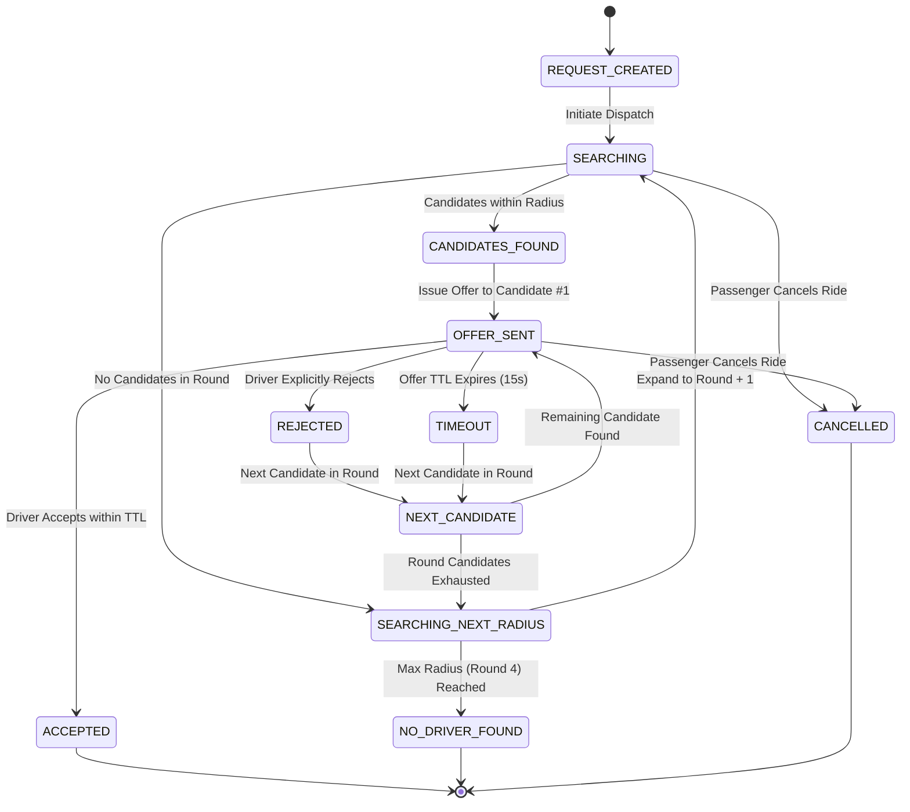

# GOZIPP Stage 3.4 Dispatch State Machine Report
**Document ID:** GOZIPP-STAGE-3-4-DISPATCH-STATE-MACHINE-REPORT  
**Project:** GOZIPP Dual Mobility Platform  
**Stage:** Stage 3 — Gate 3.4 Dispatch State Machine  
**Date:** 2026-11-08  
**Result:** 100% PASS  

---

## 1. Taxi Dispatch State Machine

The Taxi Dispatch Engine operates as a finite state machine with strict server-side validation for every transition:

---

## 2. State Transition Rules and Guards

| Transition | From State | To State | Trigger / Guard | Server Side Action |
| :--- | :--- | :--- | :--- | :--- |
| **T1: Start Search** | `REQUEST_CREATED` | `SEARCHING` | Trip is in `SEARCHING` status | Initialize `excludedDriverIds`, query Round 1 (1.5 km) |
| **T2: Candidates Found** | `SEARCHING` | `CANDIDATES_FOUND` | Candidate count $\ge 1$ | Sort candidates via Driver Ranking Engine |
| **T3: Issue Offer** | `CANDIDATES_FOUND` | `OFFER_SENT` | Top candidate available | Generate unique `offerId`, set TTL in Redis, emit WebSocket |
| **T4: Acceptance** | `OFFER_SENT` | `ACCEPTED` | Driver accepts within TTL | **PostgreSQL Global Lock Transaction**, status `BUSY` |
| **T5: Rejection** | `OFFER_SENT` | `REJECTED` | Driver sends reject event | Exclude driver, clean Redis offer key |
| **T6: Offer Timeout** | `OFFER_SENT` | `TIMEOUT` | Server timer expires (15s) | Exclude driver, clean Redis offer key |
| **T7: Next Candidate** | `REJECTED` / `TIMEOUT` | `NEXT_CANDIDATE` | More candidates in round | Advance index, issue offer to Candidate #2 |
| **T8: Radius Expand** | `NEXT_CANDIDATE` | `SEARCHING_NEXT_RADIUS` | No more candidates in round | Increment search round ($1 \rightarrow 2 \rightarrow 3 \rightarrow 4$) |
| **T9: No Driver Found** | `SEARCHING_NEXT_RADIUS` | `NO_DRIVER_FOUND` | Round 4 exhausted | Emit `NO_TAXI_AVAILABLE`, record telemetry |
| **T10: Passenger Cancel** | Any Active State | `CANCELLED` | Passenger cancels ride | Delete Redis offer, release locks, refund points |

---

## 3. Server-Authoritative Integrity Guarantees

1. **Anti-Spoofing:** Client-side timers are purely visual. If a client attempts to submit an acceptance 1 millisecond after server expiration, the server strictly returns `400 Bad Request` (`ข้อเสนองานนี้หมดเวลาตอบรับแล้ว`).
2. **Crash & Network Recovery:** If a driver drops connection during `OFFER_SENT`, the 15-second server timer guarantees the trip will not hang; it automatically fails over to `NEXT_CANDIDATE`.
3. **Re-Verification on Acceptance:** When `acceptOffer()` is called, the system re-verifies that the driver is not suspended and the vehicle is still `VERIFIED` before committing the transaction.
