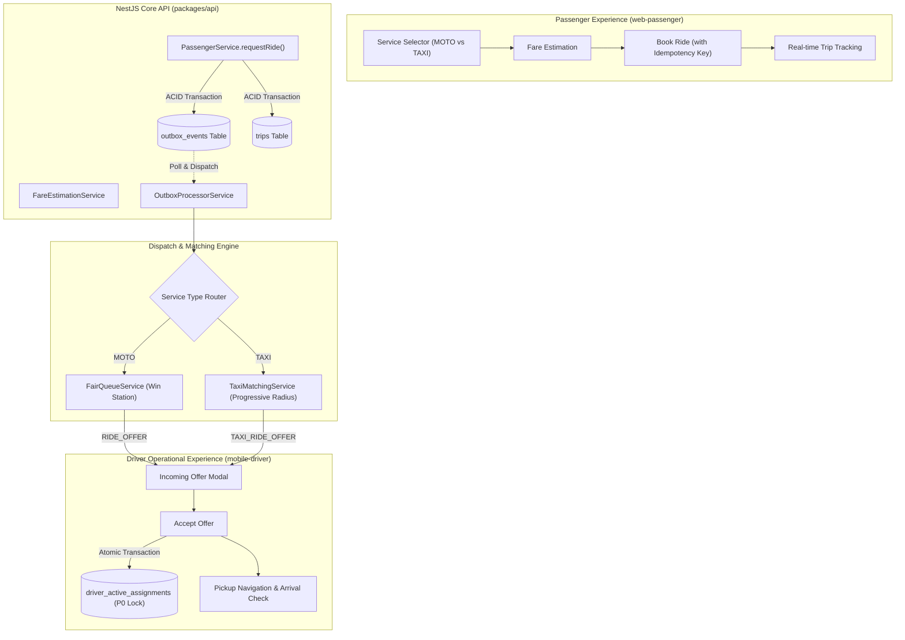
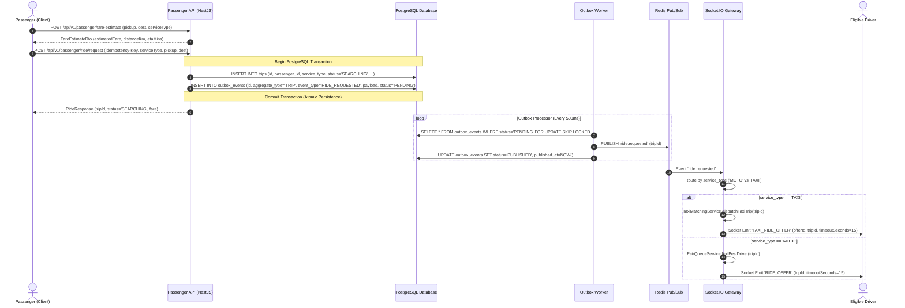
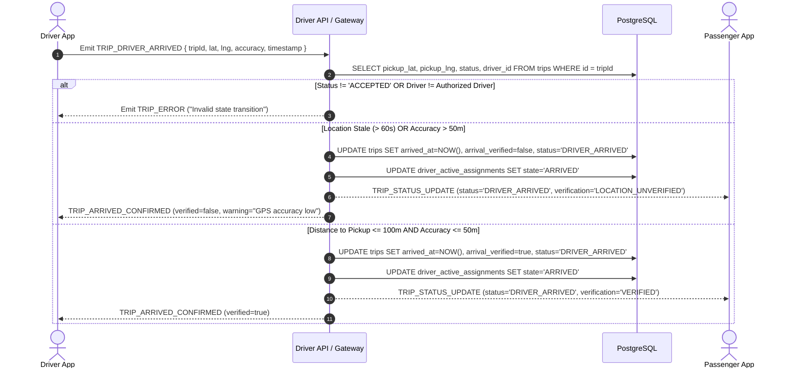
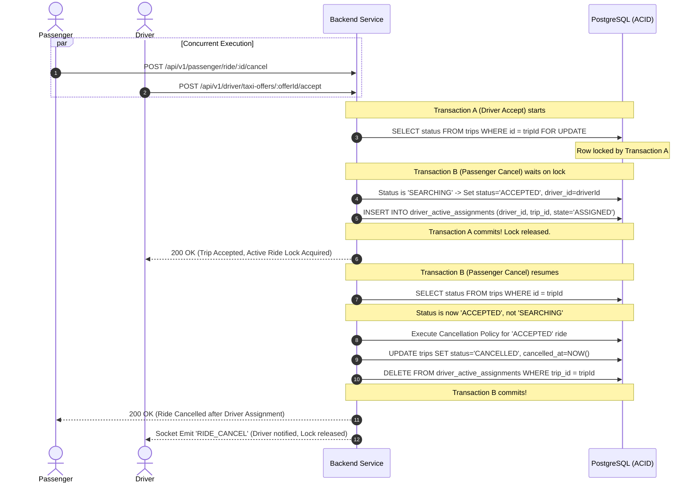

# GOZIPP DUAL MOBILITY PLATFORM — STAGE 4
## Gate B: End-to-End Architecture Design & System Interaction Specification

**Document ID:** GOZIPP-STAGE-4-ARCHITECTURE-DESIGN  
**Version:** 1.0  
**Status:** DESIGN CERTIFIED  
**Architect:** Antigravity AI Engineering Engine  
**Target Environment:** Development / Staging Isolation  
**Date:** 2026-11-08  

---

## 1. System Architecture Overview

The Stage 4 Passenger Booking and Driver Operational Experience extends the GOZIPP platform to deliver a unified yet strictly isolated dual mobility journey for both **MOTO** (Motorcycle Taxi) and **TAXI** (`PUBLIC_TAXI` and `PRIVATE_CAR_FOR_HIRE`).

The architecture is governed by four core architectural pillars:
1. **Preserve MOTO Integrity:** MOTO matching (`FairQueueService`), 0% GP driver commission, and 2 THB passenger system fee remain completely unaltered.
2. **Isolate TAXI Dispatch:** TAXI matching runs through `TaxiMatchingService` with progressive radius expansion (1.5 km $\rightarrow$ 3.0 km $\rightarrow$ 5.0 km $\rightarrow$ 8.0 km) and deterministic scoring. Public booking remains strictly disabled via feature flag `TAXI_PUBLIC_BOOKING_ENABLED=false`.
3. **P0 Global Active Ride Lock:** A single driver may hold at most one active ride across all mobility services, guaranteed by PostgreSQL atomic constraints on `driver_active_assignments`.
4. **Transactional Outbox Reliability:** Trip creation and dispatch trigger events are bound in a single ACID database transaction, eliminating ghost rides and silent dispatch failures.

---

## 2. End-to-End Sequence Workflows

### 2.1 Dual Mobility Booking & Transactional Outbox Dispatch Sequence

The following sequence illustrates the transactional guarantee ensuring no trip is created without an associated dispatch event.

---

### 2.2 Driver Arrival Verification Sequence

Arrival verification prevents fraudulent or premature "Driver Arrived" claims by combining GPS geofence checks, coordinate accuracy thresholds, and location freshness rules.

---

### 2.3 Concurrency & Race Condition Resolution: Passenger Cancel vs Driver Accept

When a passenger attempts to cancel a ride at the exact moment a driver attempts to accept it, the database atomic transaction guarantees deterministic resolution.

---

## 3. Component Responsibilities

### 3.1 Web Passenger Frontend (`apps/web-passenger`)
1. **Service Selector Component:** Tab toggle between `MOTO` and `TAXI`. When TAXI is selected:
   - Displays vehicle category options (`PUBLIC_TAXI` and `PRIVATE_CAR_FOR_HIRE`).
   - If `TAXI_PUBLIC_BOOKING_ENABLED=false`, displays an explanatory testing banner: *"GOZIPP TAXI is currently undergoing internal staging certification. Public bookings will be activated soon."*
2. **Fare Quotation Display:** Visualizes estimated fare range, distance, and ETA calculated by `FareEstimationService`.
3. **Idempotent Ride Request:** Generates a client-side UUID `Idempotency-Key` sent with the ride creation request to avoid duplicate bookings during poor mobile network conditions.
4. **Driver Arrival Notification:** Displays verified arrival badge or unverified warning badge based on server verification status.

### 3.2 Mobile Driver Frontend (`apps/mobile-driver`)
1. **Multi-Service Availability Indicators:** Displays dual status toggles for MOTO and TAXI availability in the driver dashboard.
2. **Incoming Job Sheet Modal:**
   - Handles both `RIDE_OFFER` (MOTO) and `TAXI_RIDE_OFFER` (TAXI).
   - Shows badge: `[MOTO]` vs `[PUBLIC_TAXI]` vs `[PRIVATE_CAR_FOR_HIRE]`.
   - Displays Pickup Area, Destination Summary, Estimated Distance, ETA, and 15-second countdown timer.
3. **Arrived Confirmation Action:** Captures high-accuracy GPS coordinates (`accuracy`, `lat`, `lng`, `timestamp`) and transmits them with `TRIP_DRIVER_ARRIVED`.
4. **Active Ride Lock Awareness:** If driver already has an active trip in one service, the UI immediately locks new offer acceptance across all services.

### 3.3 Backend Core (`packages/api`)
1. **`FareEstimationService`:** Pure backend domain service calculating distance-based pricing. Strictly enforces 2 THB fee for MOTO, and blocks real financial transactions for TAXI.
2. **`OutboxService` & `OutboxEventEntity`:** Implements reliable, at-least-once message publishing via PostgreSQL outbox table with correlation IDs and exponential backoff.
3. **`DriverService` Arrival Verification:** Validates Euclidean/Haversine distance between driver coordinates and pickup coordinates ($\le 100\text{m}$), GPS accuracy ($\le 50\text{m}$), and timestamp freshness ($\le 60\text{s}$).
4. **`AppGateway` Router:** Dynamically routes dispatch requests to `FairQueueService` (MOTO) or `TaxiMatchingService` (TAXI).

---

## 4. Architectural Boundaries & Non-Negotiable Constraints
- **Zero Payment Capture:** No credit card charging, payment gateway tokenization, or bank debiting shall occur in Stage 4.
- **Zero Public Taxi Launch:** Feature flag `TAXI_PUBLIC_BOOKING_ENABLED` defaults to `false`.
- **Zero Alteration to MOTO Pricing:** MOTO remains 0% GP driver commission and 2 THB passenger system fee.
