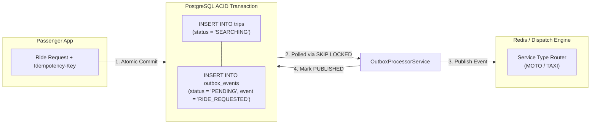

# GOZIPP DUAL MOBILITY PLATFORM — STAGE 4
## Gate B: Booking & Dispatch Reliability Specification (Transactional Outbox)

**Document ID:** GOZIPP-STAGE-4-BOOKING-DISPATCH-RELIABILITY  
**Version:** 1.0  
**Status:** SPECIFICATION CERTIFIED  
**Reliability Engineer:** Antigravity AI Engineering Engine  
**Target Environment:** Development / Staging Isolation  
**Date:** 2026-11-08  

---

## 1. Problem Statement & Architectural Mandate

In standard ride-hailing implementations, a critical failure mode occurs when a ride request is committed to the database (`INSERT INTO trips`), but the subsequent dispatch trigger (e.g., Redis Pub/Sub, message queue, or in-memory async task) fails due to a network glitch, process crash, or message broker restart.

This failure mode produces **"Ghost Trips"**: trips that are persistently saved in the database with status `SEARCHING`, but which are completely invisible to the matching engine because no dispatch event was delivered. The passenger sits waiting indefinitely until a timeout occurs.

To permanently eliminate this vulnerability, **Section 7 (Stage 4.4)** of the Master Implementation Directive mandates the implementation of the **Transactional Outbox Pattern**.

---

## 2. Transactional Outbox Architecture

### 2.1 The Two-Phase Persistence Pattern

Under this pattern, the database write for the `trips` record and the insertion of the outbound event into `outbox_events` are executed within the **exact same ACID transaction**:



If either the trip creation or the event recording fails, the entire transaction rolls back. Neither can exist without the other.

---

## 3. Outbox Processor Design & Concurrency Handling

### 3.1 Non-Blocking Distributed Polling (`SKIP LOCKED`)
To support horizontal scaling of backend API instances without event duplication or lock contention, the processor queries pending outbox events using PostgreSQL's `FOR UPDATE SKIP LOCKED`:

```sql
SELECT id, aggregate_id, event_type, payload, retry_count, correlation_id
FROM outbox_events
WHERE status = 'PENDING'
ORDER BY created_at ASC
LIMIT 50
FOR UPDATE SKIP LOCKED;
```

Each running instance grabs an exclusive lock on a distinct batch of rows. Other instances skip those rows immediately without blocking.

### 3.2 Exponential Backoff and Jitter
If an attempt to publish an event fails (e.g., Redis connection lost), the event is not dropped. The processor increments `retry_count` and calculates a delayed retry interval:

$$\text{NextRetryDelay} = \min(300\text{ s}, 2^{\text{retry\_count}} \times 1\text{ s}) + \text{jitter}(0, 500\text{ ms})$$

### 3.3 Dead-Letter / Failed Event State
If an event exceeds `max_retries` (default 5 attempts):
1. Its status transitions from `PENDING` to `FAILED`.
2. The exact error stack and timestamp are captured in `last_error`.
3. An administrative alert is logged to the system audit log with the `correlation_id`.
4. A dead-letter recovery API allows operations to inspect and re-queue failed events once connectivity is restored.

---

## 4. Idempotency Key Governance

To prevent double-booking caused by rapid taps on mobile devices or network retries, all booking requests must support an `Idempotency-Key` header:

```typescript
// Idempotency Resolution Workflow:
const existingTrip = await this.tripRepo.findOne({
  where: { idempotency_key: idempotencyKey }
});

if (existingTrip) {
  this.logger.log(`Duplicate booking prevented by idempotency key: ${idempotencyKey}`);
  return {
    tripId: existingTrip.id,
    status: existingTrip.status,
    fare: existingTrip.fare,
    isDuplicate: true,
    message: 'Returning existing booking for idempotency key.'
  };
}
```

---

## 5. End-to-End Correlation Tracking

Every ride request is assigned a `correlation_id` (format: `corr-<tripId>-<timestamp>`) that traverses:
1. `RideRequestDto`
2. `trips.id`
3. `outbox_events.correlation_id`
4. Redis Pub/Sub message payload
5. `TaxiMatchingService` / `FairQueueService` dispatch logs
6. Socket.IO offer emits to drivers

This provides 100% observability across the entire passenger-to-driver lifecycle.
