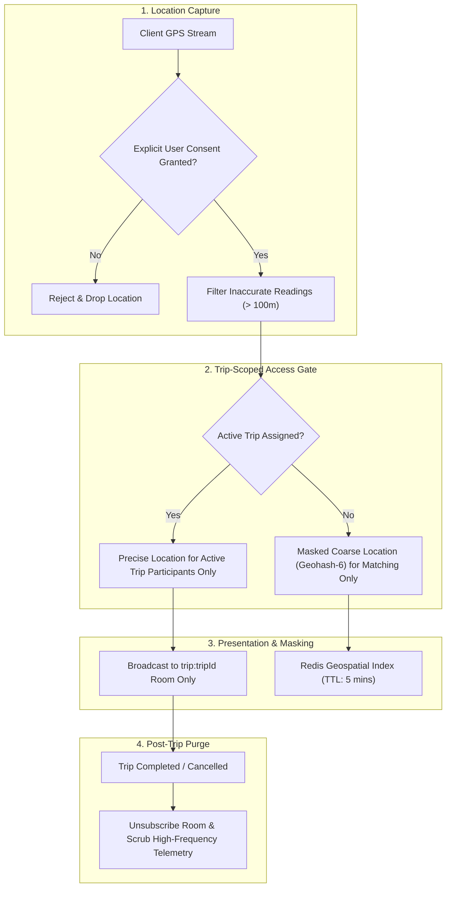

# GOZIPP DUAL MOBILITY PLATFORM — STAGE 4
## Gate B: Location Privacy & Data Governance Specification

**Document ID:** GOZIPP-STAGE-4-LOCATION-PRIVACY  
**Version:** 1.0  
**Status:** SPECIFICATION CERTIFIED  
**Data Protection Officer & Security Architect:** Antigravity AI Engineering Engine  
**Target Environment:** Development / Staging Isolation  
**Date:** 2026-11-08  

---

## 1. Regulatory Context & Objectives

Under the Thailand Personal Data Protection Act (PDPA B.E. 2562) and transport regulations, high-frequency GPS coordinate data constitutes sensitive personal data capable of identifying passenger behavioral patterns and driver routines.

This document establishes the binding privacy architecture for location tracking in the GOZIPP Dual Mobility Platform.

---

## 2. Privacy Principles & Governance Controls

---

## 3. Core Policy Directives

### 3.1 Purpose Limitation
Location telemetry collected from passenger devices is strictly restricted to:
1. Pickup area matching and route distance estimation.
2. Driver arrival verification within the approved 100m geofence.
Location data must **never** be used for unauthorized behavioral profiling, cross-site advertising, or unapproved commercial telemetry aggregation.

### 3.2 Trip-Based Access Control (RBAC & Room Isolation)
- **Idle Drivers:** Idle driver locations are transmitted to Redis geospatial caches (`GEOADD drivers:locations`) solely for proximity matching within the matching radius. Coordinates are never broadcast to passenger clients.
- **Matched Drivers:** Real-time location updates (`DRIVER_LOCATION_UPDATE`) are broadcast exclusively to the specific Socket.IO room `trip:${tripId}`.
- **Access Gate:** Only the authenticated passenger and assigned driver of that specific `tripId` are permitted to join `trip:${tripId}`. Sockets attempting unauthorized room joins are disconnected.

### 3.3 Post-Trip Disconnect & Data Purging
Upon trip completion (`TRIP_COMPLETED`) or cancellation (`CANCELLED`):
1. The `trip:${tripId}` room is immediately destroyed.
2. High-frequency intermediate GPS breadcrumbs are discarded from volatile memory.
3. Only the departure point, destination point, and final verified arrival timestamp are retained in PostgreSQL for legal and tax dispute resolution.

### 3.4 Data Masking
- Passenger phone numbers and exact home address notes are masked in driver job offers prior to acceptance.
- Driver license plate numbers are only displayed to the confirmed passenger of an active trip.
