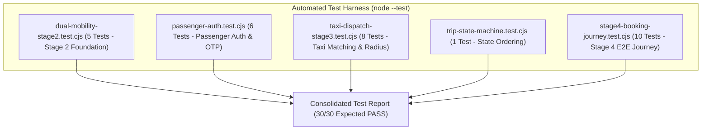

# GOZIPP DUAL MOBILITY PLATFORM — STAGE 4
## Gate B: Comprehensive Test Strategy & Acceptance Matrix

**Document ID:** GOZIPP-STAGE-4-TEST-STRATEGY  
**Version:** 1.0  
**Status:** STRATEGY CERTIFIED  
**Lead QA & Verification Engineer:** Antigravity AI Engineering Engine  
**Target Environment:** Development / Staging Isolation  
**Date:** 2026-11-08  

---

## 1. Executive Summary

This document specifies the verification methodology, automated test suites, concurrency stress tests, and acceptance criteria for **Stage 4: Passenger Booking & Driver Operational Experience**.

In strict compliance with **Section 19 (Testing & Acceptance Criteria)**:
- **Evidence-First Rule:** "NO EVIDENCE = NO PASS". No feature may be certified based on static code inspection alone.
- **Automated Verification Harness:** All tests will execute via Node.js native test runner (`node --test packages/api/test/*.test.cjs`).
- **Regression Invariant:** Existing 20 test cases from Stage 2 and Stage 3 must continue to pass with 0 failures.

---

## 2. Test Architecture & Test Suite Organization

---

## 3. Stage 4 Test Groups & Test Case Specifications

The new test suite `packages/api/test/stage4-booking-journey.test.cjs` will implement the following 10 targeted test groups:

| Test ID | Test Group | Description | Success Criteria | Priority |
|---|---|---|---|---|
| **ST4-01** | **Transactional Outbox Persistence** | Verify that creating a ride request persists both the trip and a matching `outbox_events` record in an atomic transaction. | Both records exist with matching `tripId` and `correlation_id`. | **P0** |
| **ST4-02** | **Outbox Processor Publishing & Retry** | Verify that the Outbox Worker polls pending events, publishes to Redis, and marks status as `PUBLISHED`. | Event status transitions from `PENDING` to `PUBLISHED` with timestamp. | **P0** |
| **ST4-03** | **Idempotent Ride Booking** | Submit two consecutive booking requests with identical `Idempotency-Key`. | Second request returns `200 OK` with existing `tripId`; only 1 trip record created. | **P1** |
| **ST4-04** | **Dual Mobility Service Routing** | Request a MOTO ride vs a TAXI ride. | MOTO routes to `FairQueueService`; TAXI routes to `TaxiMatchingService`. | **P0** |
| **ST4-05** | **TAXI Public Booking Feature Flag Guard** | Attempt to book a TAXI ride when `TAXI_PUBLIC_BOOKING_ENABLED=false`. | Request rejected with `400 Bad Request` and explanatory staging message. | **P0** |
| **ST4-06** | **Fare Estimation Separation** | Call fare estimate for MOTO (0% GP, 2 THB fee) and TAXI (unconfirmed test quotation). | MOTO returns confirmed 2 THB fee; TAXI returns staging disclaimer and unconfirmed flag. | **P1** |
| **ST4-07** | **Driver Arrival Geofence Verification** | Submit `TRIP_DRIVER_ARRIVED` within 50m of pickup vs 250m away. | $\le 100\text{m}$ sets `arrival_verified=true`; $> 100\text{m}$ sets `arrival_verified=false` with warning. | **P1** |
| **ST4-08** | **Full Trip Lifecycle Progression** | Step through: `SEARCHING` $\rightarrow$ `ACCEPTED` $\rightarrow$ `DRIVER_ARRIVED` $\rightarrow$ `IN_PROGRESS` $\rightarrow$ `COMPLETED`. | State transitions in valid order; timestamps recorded at each step. | **P0** |
| **ST4-09** | **Cancellation Race Condition** | Driver accepts at the exact moment Passenger cancels. | One wins cleanly; locks released; zero orphaned active assignments. | **P0** |
| **ST4-10** | **Cross-Service Active Ride Lock Invariant** | Driver with active MOTO ride attempts to accept a TAXI offer. | TAXI accept rejected with `409 Conflict`; Global Active Ride Lock maintained. | **P0** |

---

## 4. Acceptance Criteria & Pass/Fail Thresholds

To achieve **PASS** status for Stage 4 Final Certification:
1. **100% Pass Rate:** All 10 Stage 4 tests must pass.
2. **Zero Regression:** All 20 Stage 2 and Stage 3 regression tests must pass.
3. **Zero Known P0/P1 Defects:** No open high-severity issues.
4. **Build Integrity:** Monorepo build `npx tsc -b` must succeed with zero TypeScript errors.
5. **No Production Execution:** All tests must run in isolated development/staging test harnesses.
