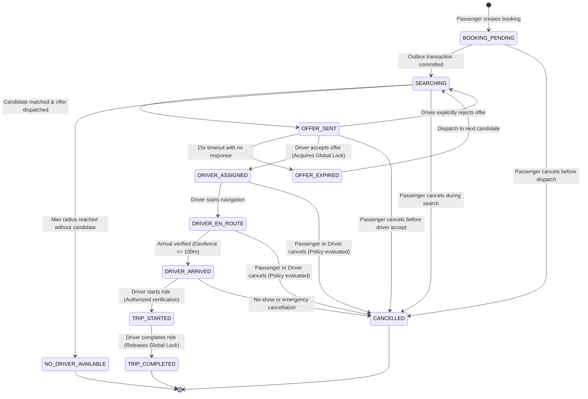

# GOZIPP DUAL MOBILITY PLATFORM — STAGE 4
## Gate B: Trip Lifecycle State Machine & Transition Governance

**Document ID:** GOZIPP-STAGE-4-TRIP-STATE-MACHINE  
**Version:** 1.0  
**Status:** STATE MACHINE CERTIFIED  
**Systems Architect:** Antigravity AI Engineering Engine  
**Target Environment:** Development / Staging Isolation  
**Date:** 2026-11-08  

---

## 1. Executive Summary

This document specifies the formal state lifecycle for trips within the GOZIPP Dual Mobility Platform, covering both **MOTO** and **TAXI** services.

Every state transition is strictly server-authoritative. Clients (Passenger and Driver apps) submit intent commands via authenticated APIs or WebSockets; the backend verifies identity, state preconditions, and concurrency locks before committing any state change to PostgreSQL and broadcasting updates.

---

## 2. State Transition Matrix & Governance

---

## 3. Detailed Transition Rules & Preconditions

| Transition ID | From State | To State | Authorized Actor | Preconditions | Side Effects & Lock Actions |
|---|---|---|---|---|---|
| **T-01** | `None` | `BOOKING_PENDING` | Passenger | Authenticated passenger, valid coordinates. | Write to `trips` & `outbox_events`. |
| **T-02** | `BOOKING_PENDING` | `SEARCHING` | Outbox Worker | Outbox event published to broker. | Redis hash initialized, timeout scheduled. |
| **T-03** | `SEARCHING` | `OFFER_SENT` | Matching Engine | Candidate driver found, verified, and free. | Temporary offer lock set in Redis (15s TTL). |
| **T-04** | `OFFER_SENT` | `DRIVER_ASSIGNED` | Driver | Offer valid, not expired, driver matches offer. | **Atomic Acquisition of Global Active Ride Lock (`driver_active_assignments`).** |
| **T-05** | `DRIVER_ASSIGNED` | `DRIVER_EN_ROUTE` | Driver | Assigned driver matches `trips.driver_id`. | Assignment state set to `EN_ROUTE`. |
| **T-06** | `DRIVER_EN_ROUTE` | `DRIVER_ARRIVED` | Driver | Assigned driver, distance $\le 100\text{m}$, accuracy $\le 50\text{m}$. | Record `arrived_at`, set `arrival_verified=true`. |
| **T-07** | `DRIVER_ARRIVED` | `TRIP_STARTED` | Driver | Assigned driver, trip state `DRIVER_ARRIVED`. | Record `started_at`, state set to `IN_PROGRESS`. |
| **T-08** | `TRIP_STARTED` | `TRIP_COMPLETED` | Driver | Assigned driver, trip state `IN_PROGRESS`. | Record `completed_at`, **Release Global Active Ride Lock**. |
| **T-09** | `SEARCHING` / `ASSIGNED` | `CANCELLED` | Passenger / Driver | Trip not yet completed or started. | Record `cancelled_at`, **Release Global Active Ride Lock if held**. |
| **T-10** | `SEARCHING` | `NO_DRIVER_AVAILABLE` | System | All dispatch rounds exhausted without match. | Clean up Redis state, notify passenger. |

---

## 4. Arrival Verification Telemetry & Fallback Rules

### 4.1 Geofence Calculation Formula
The backend calculates the Haversine distance $D$ between driver GPS coordinates $(\phi_d, \lambda_d)$ and pickup coordinates $(\phi_p, \lambda_p)$:

$$a = \sin^2\left(\frac{\Delta\phi}{2}\right) + \cos(\phi_d)\cos(\phi_p)\sin^2\left(\frac{\Delta\lambda}{2}\right)$$
$$D = 2 \cdot R \cdot \text{atan2}\left(\sqrt{a}, \sqrt{1 - a}\right) \quad (\text{where } R = 6,371,000\text{ meters})$$

### 4.2 Telemetry Verification Criteria
1. **Geofence Threshold:** $D \le 100\text{ meters}$.
2. **GPS Accuracy Threshold:** $\text{Accuracy} \le 50\text{ meters}$.
3. **Location Freshness:** $|\text{ServerTimestamp} - \text{ClientTimestamp}| \le 60\text{ seconds}$.

### 4.3 Fallback Handling (`LOCATION_UNVERIFIED`)
If the driver submits an arrival confirmation when GPS signal is degraded (accuracy $> 50\text{m}$) or GPS distance is slightly outside the threshold:
- The trip transition to `DRIVER_ARRIVED` is permitted to prevent blocking passengers in dense urban canyon environments.
- However, `trips.arrival_verified` is set to `FALSE`, and `trips.arrival_verification_status` is flagged as `'LOCATION_UNVERIFIED'`.
- Both passenger and driver UIs display a cautionary notice, and the anomaly is logged to the security audit trail.

---

## 5. Trip Start & Trip Completion Evidence Standards

### 5.1 Trip Start Evidence Requirement
To execute Transition **T-07** (`DRIVER_ARRIVED` $\rightarrow$ `TRIP_STARTED`):
1. **Actor Verification:** `request.user.id` must strictly equal `trips.driver_id`.
2. **Precondition State:** Current status in PostgreSQL must equal `DRIVER_ARRIVED`.
3. **Lock Verification:** `driver_active_assignments` must contain an active record with state `ARRIVED`.
4. **Audit Record:** Emits structured log event `TRIP_STARTED_EVENT` containing tripId, driverId, vehicleId, and timestamp.

### 5.2 Trip Completion Evidence Requirement
To execute Transition **T-08** (`TRIP_STARTED` $\rightarrow$ `TRIP_COMPLETED`):
1. **Actor Verification:** `request.user.id` must strictly equal `trips.driver_id`.
2. **Precondition State:** Current status in PostgreSQL must equal `IN_PROGRESS`.
3. **Finalization:**
   - Server-authoritative timestamp recorded in `trips.completed_at`.
   - Final fare calculated based on approved fare policy (2 THB for MOTO; test quotation for TAXI).
   - Atomic release of Global Active Ride Lock (`DELETE FROM driver_active_assignments WHERE trip_id = tripId`).
   - Emit `TRIP_COMPLETED` event to `trip:<tripId>` room.
